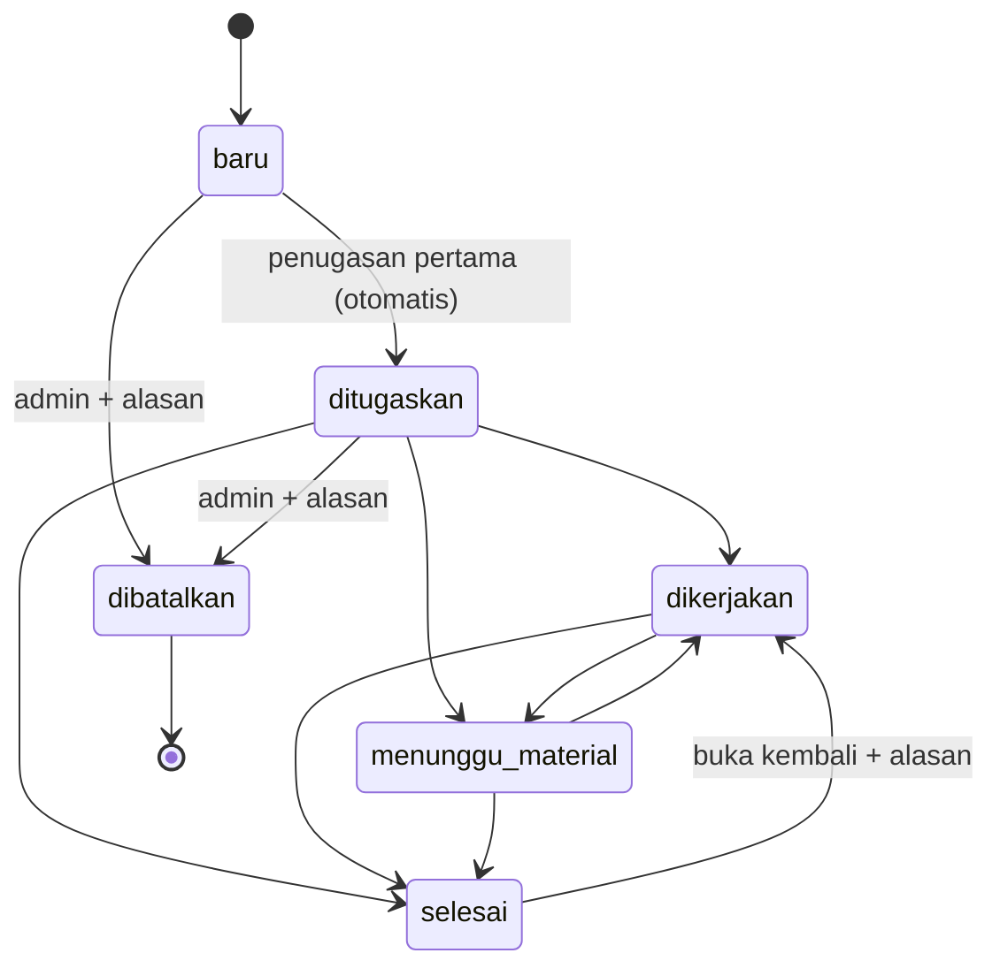

# Dashboard IPSRS — RS. Soeharto Heerdjan
## Dokumen Acuan Project (BRD + SRS + Rancangan Database)

| | |
|---|---|
| Versi dokumen | 0.8 |
| Status | Disetujui sebagai acuan awal; dilengkapi bertahap |
| Sumber | BRD v0.1 + SRS v0.1 (digabung), ditambah tech stack, rancangan database, migrasi penyempurnaan 006, dan RPC aksi atomik |
| Tech stack | React + TypeScript + Vite, Tailwind CSS, Supabase (PostgreSQL, Auth, Storage, Edge Functions) |

---

## 0. Cara Memakai Dokumen Ini (untuk developer dan AI editor)

1. Dokumen ini adalah **sumber kebenaran tunggal** project. Jangan menambah fitur, role, atau tabel di luar dokumen ini tanpa memperbarui dokumen terlebih dahulu.
2. Jika ada konflik antara kode dan dokumen, dokumen menang. Jika dokumen ambigu, **tanyakan dulu**, jangan berasumsi.
3. Setiap perubahan kebutuhan: ubah bagian terkait, naikkan versi di tabel atas, dan tambahkan baris di **Bagian 13 (Changelog)**.
4. Item yang belum pasti ada di **Bagian 12 (Hal Terbuka)**. Jangan dianggap final.
5. **Konvensi penamaan:**
   - Nama tabel, kolom, fungsi, variabel, dan file kode: **bahasa Inggris**, `snake_case` di database, `camelCase` di TypeScript.
   - Nilai enum domain memakai istilah Indonesia (`baru`, `laksana`, dll.) karena merupakan istilah bisnis. Label tampilan dipetakan di frontend (Bagian 6.4).
   - **Seluruh teks antarmuka (label, pesan, tombol) dalam bahasa Indonesia.**
6. ID kebutuhan (FR-xxx, BR-xx, NFR-xx) dipertahankan agar bisa dirujuk di commit dan issue.
7. Migrasi di `supabase/migrations/` berurutan **001-008**. Perubahan skema berikutnya = **file migrasi baru**; jangan mengedit migrasi yang sudah dijalankan di remote.
8. **Lingkungan kerja tanpa Docker dan tanpa Supabase CLI.** Database memakai project Supabase cloud; SQL dijalankan manual lewat SQL Editor, Edge Function di-deploy lewat Dashboard. Agent/developer hanya boleh menjalankan perintah Node (npm, tsc, lint, vitest, vite). Jangan menuliskan, meminta, atau menyimpan service role key, secret key, atau password database di kode, repo, maupun log.
9. Setiap objek baru di schema `public` (tabel, view, fungsi) **wajib** disertai GRANT eksplisit di file migrasi yang sama (lihat Migrasi 007).

---

## 1. Ringkasan Project

IPSRS RS. Soeharto Heerdjan menerima laporan kerusakan sarana prasarana dari ruangan melalui **grup WhatsApp**. Project ini membangun **dashboard web internal** untuk mencatat laporan sebagai tiket, menugaskan petugas teknis, memantau progres, mengelola persediaan material, dan menghasilkan rekap kinerja berdasarkan tanggal.

Prinsip utama:
- **Hanya 2 role login:** Admin-Koordinator IPSRS dan Tim Teknis-Logistik IPSRS.
- **Ruangan/pemohon bukan pengguna sistem.** Mereka melapor lewat grup WA (dibatasi anggota tertentu agar tidak ada spam), lalu admin menginput tiket.
- **Tanpa landing page pelaporan publik.**
- Sederhana, modern minimalis, latar putih.

### 1.1 Tujuan dan indikator

| ID | Tujuan | Indikator |
|---|---|---|
| T1 | Semua laporan dari WA tercatat terpusat | 100% laporan menjadi tiket |
| T2 | Penugasan dan progres terpantau | Setiap tiket punya status dan petugas jelas |
| T3 | Capaian Laksana/Gagal Laksana terukur | Persentase dan alasan tersedia di dashboard |
| T4 | Rekap tanpa kerja manual | Rekap per rentang tanggal tersedia instan |
| T5 | Persediaan material terpantau | Stok, pemakaian per tiket, peringatan stok minimum |
| T6 | Formulir fisik terarsip | Foto formulir tersimpan dan terkait tiket |

### 1.2 Dalam lingkup (versi pertama)

- Login 2 role; pembuatan tiket oleh admin; penugasan ke 1 atau lebih petugas.
- Halaman tugas tim teknis (termasuk carry-over).
- Status tiket (hanya admin), formulir selesai, unggah foto formulir fisik.
- Klasifikasi Laksana/Gagal Laksana beserta alasan.
- Riwayat catatan per tiket.
- Modul persediaan material sederhana (dikelola tim teknis).
- Data master CRUD: ruangan, petugas, jenis kerusakan, alasan gagal laksana, material.
- Dashboard 7 rekap dengan filter tanggal (hanya admin).
- Log aktivitas.
- Cetak lembar tugas (dengan QR nomor tiket).

### 1.3 Di luar lingkup (versi pertama)

- Akun atau halaman pelaporan untuk ruangan.
- Integrasi otomatis WhatsApp (bot/pembacaan pesan).
- Integrasi sistem stok gudang yang sudah ada (menunggu informasi).
- Pengadaan dan persetujuan anggaran.
- Aplikasi mobile native (web responsif sudah cukup).
- Umpan balik kepuasan digital (verifikasi lewat tanda tangan di formulir fisik).

---

## 2. Pemangku Kepentingan dan Role

| Pihak | Peran terhadap sistem |
|---|---|
| Penanggung jawab ruangan | Melapor via WA dan menandatangani formulir fisik sebagai verifikasi. **Bukan pengguna sistem.** |
| **Admin-Koordinator IPSRS** (role `admin`, 1-2 orang) | Membuat tiket, klasifikasi, prioritas, penugasan, ubah status, isi formulir selesai, unggah berkas, kelola data master, lihat dashboard dan log |
| **Tim Teknis-Logistik IPSRS** (role `teknisi`, sekitar 4 orang) | Melihat tugas sendiri, mengerjakan perbaikan, mencatat kendala, mengelola persediaan, mencatat pemakaian material |

Sistem Dashboard bukan user; ia adalah fungsi otomatis (pencatatan, klasifikasi, rekap).

---

## 3. Proses Bisnis

### 3.1 Alur to-be

1. **Laporan masuk.** Penanggung jawab ruangan melapor di grup WA.
2. **Admin membuat tiket:** ruangan, nama pelapor, waktu lapor, kendala, jenis kerusakan, prioritas, petugas (individu, boleh lebih dari satu).
3. **Tim teknis melihat tugas** di website, lalu mengambil **formulir fisik** di ruangan admin (admin dapat mencetak lembar tugas dengan nomor tiket). Disarankan admin mengubah status menjadi *Dikerjakan* saat formulir fisik diserahkan ke teknisi.
4. **Pengerjaan.** Bila material tidak tersedia, tim teknis mengerjakan tiket lain dulu. Tiket tetap terbuka berstatus *Menunggu Material* dan menjadi carry-over hari berikutnya sampai selesai.
5. **Verifikasi pelapor.** Setelah selesai, tim teknis meminta **tanda tangan pelapor** pada formulir fisik.
6. **Formulir kembali ke admin.** Admin mengisi **formulir selesai** di sistem, mengunggah foto formulir fisik, dan mengubah status.
7. **Klasifikasi.** Selesai dalam 1x24 jam = **Laksana**. Lebih dari itu = **Gagal Laksana** (waktu tidak dibatasi, alasan dicatat).
8. **Rekap.** Data masuk dashboard, bisa difilter tanggal.

### 3.2 Aturan bisnis

| Kode | Aturan |
|---|---|
| BR-01 | Hanya admin yang membuat tiket dan mengubah status tiket. |
| BR-02 | **Laksana** = selesai ≤ 1x24 jam sejak **waktu lapor**. Selebihnya **Gagal Laksana**. Batas (jam) disimpan di `app_settings.sla_hours` (default 24). Dihitung jam kalender (lihat Hal Terbuka). |
| BR-03 | Gagal Laksana tidak dibatasi waktu dan tetap dapat diselesaikan admin. |
| BR-04 | Alasan Gagal Laksana (master data): material tidak tersedia di gudang, perlu pihak ketiga/vendor, kerusakan kompleks, lainnya. |
| BR-05 | Tiket menunggu material tetap terbuka dan tampil sebagai carry-over di daftar tugas petugas. |
| BR-06 | Satu tiket = **satu laporan**; dapat ditugaskan ke satu atau lebih petugas. |
| BR-07 | Prioritas: Urgent, Tinggi, Sedang, Rendah. |
| BR-08 | Ruangan adalah data master (tambah, ubah nama, nonaktifkan). Riwayat tidak boleh rusak: tiket merujuk ID, bukan nama. |
| BR-09 | Persediaan dipantau dan dikelola **tim teknis**, bukan admin. |
| BR-10 | Dashboard hanya diakses admin. |
| BR-11 | Tiket boleh ditutup tanpa foto formulir; ditandai "formulir belum diunggah" dan tampil di daftar pantauan. |
| BR-12 | Setiap tiket punya riwayat catatan (append-only), misalnya "formulir belum diupload". |
| BR-13 | Verifikasi pelapor = tanda tangan di formulir fisik, dicatat sebagai `reporter_verified` dan `verifier_name`. |
| BR-14 | Tiket yang dibatalkan hanya dari status Baru atau Ditugaskan, wajib alasan, dan dikeluarkan dari semua rekap. |
| BR-15 | Tiket berstatus Selesai atau Dibatalkan tidak dapat ditugaskan ke petugas baru. |
| BR-16 | Waktu lapor dan waktu selesai tidak boleh di masa depan (toleransi 5 menit); waktu mulai tidak boleh sebelum waktu lapor. |
| BR-17 | Minimal harus ada satu akun admin aktif. |
| BR-18 | Tiket dibatalkan tidak boleh memiliki pemakaian material baru. |

### 3.3 Diagram status tiket



`dibatalkan` bersifat final. Klasifikasi Laksana/Gagal Laksana tidak mengubah status proses; keduanya berjalan terpisah (Bagian 5.2, fungsi `tickets_before_write`).

---

## 4. Kebutuhan Fungsional (SRS)

### 4.1 Hak akses

| Fitur | Admin | Teknisi |
|---|---|---|
| Login | Ya | Ya |
| Buat/ubah tiket | Ya | Tidak |
| Menugaskan petugas | Ya | Tidak |
| Melihat tiket | Semua | Hanya yang ditugaskan kepadanya |
| Ubah status tiket | Ya | Tidak |
| Tambah catatan tiket | Ya | Ya (pada tiket miliknya) |
| Formulir selesai + unggah foto | Ya | Tidak |
| Kelola material dan stok | Lihat saja | Ya (CRUD material, stok masuk, koreksi) |
| Catat pemakaian material di tiket | Ya | Ya (tiket miliknya) |
| CRUD ruangan, petugas, jenis kerusakan, alasan gagal | Ya | Tidak (hanya baca) |
| Dashboard dan rekap | Ya | Tidak |
| Log aktivitas | Ya | Tidak |

### 4.2 Autentikasi dan pengguna

| ID | Kebutuhan |
|---|---|
| FR-AUTH-01 | Login dengan **username** dan kata sandi (Supabase Auth; username dipetakan ke email semu `username@ipsrs.local`). |
| FR-AUTH-02 | Menu dan data dibatasi per role di frontend **dan** database (RLS). |
| FR-AUTH-03 | Admin menambah, menonaktifkan, dan mereset kata sandi akun teknisi melalui Edge Function (service role key tidak boleh ada di frontend). |
| FR-AUTH-04 | Sesi berakhir otomatis setelah 30 menit tanpa interaksi pengguna. |
| FR-AUTH-05 | Pengguna nonaktif tidak bisa login dan tidak bisa mengakses data. |
| FR-AUTH-06 | Sistem menolak menonaktifkan atau menurunkan role admin aktif terakhir (BR-17). |
| FR-AUTH-07 | Username: huruf kecil, angka, titik, garis bawah, strip; 3-30 karakter. Kata sandi minimal 8 karakter. Pendaftaran mandiri (sign-up) dimatikan di Supabase Auth. |
| FR-AUTH-08 | Setiap pengguna dapat mengganti kata sandinya sendiri di halaman `/profil` (kata sandi lama tidak diminta; sesi aktif sudah cukup). Lupa kata sandi ditangani admin lewat reset (FR-AUTH-03). |
| FR-AUTH-09 | Domain email semu untuk login (`username@<domain>`) ditentukan oleh **satu konstanta** (`LOGIN_EMAIL_DOMAIN`, default `ipsrs.local`) di frontend dan Edge Function, agar mudah diganti bila Supabase menolak domain tersebut. |

### 4.3 Tiket (admin)

| ID | Kebutuhan |
|---|---|
| FR-TKT-01 | Buat tiket: nomor tiket (otomatis), ruangan, nama pelapor, **waktu lapor** (diisi manual sesuai jam di WA; default sekarang), deskripsi kendala, jenis kerusakan, prioritas, catatan awal opsional. |
| FR-TKT-02 | Prioritas: urgent, tinggi, sedang, rendah (default sedang). |
| FR-TKT-03 | Waktu input tercatat otomatis (`created_at`), terpisah dari waktu lapor. |
| FR-TKT-04 | Admin dapat mengubah data tiket; perubahan tercatat di log. |
| FR-TKT-05 | Daftar tiket: cari dan filter berdasarkan status, prioritas, ruangan, petugas, jenis kerusakan, tanggal. |
| FR-TKT-06 | Penanda tiket mendekati 24 jam (≥ `sla_warning_hours`, default 20) dan melewati 24 jam. |
| FR-TKT-07 | Tiket tidak dihapus; salah input → dibatalkan dengan alasan. |
| FR-TKT-08 | Cetak lembar tugas: nomor tiket, QR code, ruangan, pelapor, kendala, prioritas, petugas, kolom tanda tangan. |
| FR-TKT-09 | Validasi waktu sesuai BR-16, di form dan di database. |
| FR-TKT-10 | Daftar tiket memakai paginasi sisi server (default 20 per halaman), urut waktu lapor terbaru; pencarian teks pada nomor tiket, nama pelapor, dan deskripsi. |
| FR-TKT-11 | Pencegahan konflik edit: pembaruan tiket menyertakan `updated_at` terakhir yang dilihat; bila sudah berubah, tampilkan pesan agar memuat ulang. |
| FR-TKT-12 | Saat membuat tiket, tampilkan peringatan (tidak memblokir) bila sudah ada tiket berjalan untuk ruangan dan jenis kerusakan yang sama. |
| FR-TKT-13 | Admin dapat mencatat tingkat kesulitan tiket secara opsional: `low`, `medium`, atau `hard`; tampilkan pada daftar, detail, dan lembar cetak tiket. |

### 4.4 Penugasan

| ID | Kebutuhan |
|---|---|
| FR-ASG-01 | Satu tiket ditugaskan ke satu atau lebih teknisi aktif. |
| FR-ASG-02 | Admin dapat menambah atau melepas petugas pada tiket berjalan; riwayat tersimpan (`released_at`). |
| FR-ASG-03 | Satu petugas boleh memegang banyak tiket. |
| FR-ASG-04 | Satu petugas dapat ditandai penanggung jawab utama (`is_lead`). |
| FR-ASG-05 | Penugasan pertama pada tiket berstatus Baru otomatis mengubah status menjadi Ditugaskan. |

### 4.5 Halaman tugas tim teknis

| ID | Kebutuhan |
|---|---|
| FR-TSK-01 | Teknisi melihat tiket miliknya, urut prioritas lalu waktu lapor. |
| FR-TSK-02 | Carry-over (belum selesai dari hari sebelumnya, termasuk Menunggu Material) ditampilkan jelas dengan lama berjalan. |
| FR-TSK-03 | Detail tiket: ruangan, kendala, prioritas, rekan satu tim, catatan. |
| FR-TSK-04 | Teknisi menambah catatan kendala (misal "material tidak tersedia"); tidak mengubah status. |
| FR-TSK-05 | Teknisi mencatat material terpakai; stok berkurang otomatis. |

### 4.6 Status, klasifikasi, penyelesaian

| ID | Kebutuhan |
|---|---|
| FR-STS-01 | Status: `baru`, `ditugaskan`, `dikerjakan`, `menunggu_material`, `selesai`, `dibatalkan`. Hanya admin yang mengubah. |
| FR-STS-02 | Setiap perubahan status tercatat (siapa, kapan) di `ticket_status_history`. Catatan alasan lewat `ticket_notes`. |
| FR-STS-03 | **Formulir selesai** (admin): waktu mulai, waktu selesai, tindakan yang dilakukan, material terpakai, status verifikasi pelapor, nama penandatangan, foto formulir. |
| FR-STS-04 | Durasi = waktu selesai − waktu lapor. |
| FR-STS-05 | Klasifikasi otomatis saat selesai: ≤ `sla_hours` = Laksana, selebihnya Gagal Laksana. |
| FR-STS-06 | Tiket berjalan yang melewati batas dianggap Gagal Laksana pada dashboard (`effective_classification`), tetap berjalan tanpa batas waktu. |
| FR-STS-07 | Gagal Laksana wajib memilih alasan; nama vendor dan keterangan opsional. |
| FR-STS-08 | Tiket boleh ditutup tanpa foto; muncul di daftar "formulir belum diunggah". |
| FR-STS-09 | Admin dapat membuka kembali tiket selesai (kembali ke Dikerjakan) dengan alasan di catatan; tercatat di log. |
| FR-STS-10 | Penyelesaian tiket memakai `rpc_finish_ticket` (atomik: formulir selesai + material terpakai + status selesai dalam satu transaksi). Berkas diunggah **setelahnya**. |
| FR-STS-11 | Perubahan status lain memakai `rpc_change_status`; membuka kembali memakai `rpc_reopen_ticket` (alasan wajib dan otomatis menjadi catatan tiket). |
| FR-STS-12 | Material yang sudah tercatat pada tiket (oleh teknisi atau admin) tampil hanya-baca di formulir selesai; formulir hanya menambah pemakaian baru. Kesalahan diperbaiki lewat koreksi stok. |

### 4.7 Catatan tiket

| ID | Kebutuhan |
|---|---|
| FR-NTE-01 | Riwayat catatan (isi, penulis, waktu); tidak dapat diubah atau dihapus. |
| FR-NTE-02 | Admin dan teknisi (pada tiket miliknya) dapat menambah catatan. |
| FR-NTE-03 | Catatan terbaru tampil di daftar tiket. |

### 4.8 Unggah formulir

| ID | Kebutuhan |
|---|---|
| FR-FRM-01 | Admin mengunggah foto/pindaian (JPG, PNG, PDF) dan mengaitkan ke tiket. |
| FR-FRM-02 | Satu tiket boleh punya lebih dari satu berkas. |
| FR-FRM-03 | Maks 10 MB per berkas; gambar dimampatkan di sisi klien sebelum unggah. |
| FR-FRM-04 | Daftar tiket selesai yang belum punya berkas. |
| FR-FRM-05 | Berkas disimpan di bucket **privat**; ditampilkan lewat signed URL berumur pendek. |

### 4.9 Persediaan material

| ID | Kebutuhan |
|---|---|
| FR-INV-01 | Master material: kode, nama, kategori, satuan, stok minimum. |
| FR-INV-02 | Mutasi stok: masuk, keluar, koreksi. **Stok awal dicatat sebagai mutasi masuk.** |
| FR-INV-03 | Pemakaian di tiket = mutasi keluar yang terkait tiket; stok berkurang otomatis. |
| FR-INV-04 | Peringatan bila stok ≤ stok minimum. |
| FR-INV-05 | Koreksi stok (opname) wajib alasan. |
| FR-INV-06 | Mutasi tidak bisa diubah/dihapus (append-only); kesalahan diperbaiki dengan koreksi. |
| FR-INV-07 | Riwayat mutasi dapat difilter tanggal. |
| FR-INV-08 | `current_stock` hanya diubah oleh trigger, tidak boleh ditulis dari frontend. |

### 4.10 Data master

| ID | Kebutuhan |
|---|---|
| FR-MST-01 | CRUD ruangan: tambah, ubah nama, nonaktifkan. |
| FR-MST-02 | CRUD petugas (terhubung akun). |
| FR-MST-03 | CRUD jenis kerusakan (listrik, plumbing, AC, sipil, dll.). |
| FR-MST-04 | CRUD alasan Gagal Laksana. |
| FR-MST-05 | Tidak ada hapus permanen; hanya nonaktifkan (`is_active`). Data nonaktif tidak muncul di pilihan form baru, tetapi tetap tampil di riwayat. |
| FR-MST-06 | Nama ruangan/jenis unik (tidak membedakan huruf besar-kecil). |

### 4.11 Dashboard (admin)

| ID | Kebutuhan |
|---|---|
| FR-DSH-01 | Semua rekap memiliki filter rentang tanggal. |
| FR-DSH-02 | Acuan tanggal: **tanggal lapor** (default) atau **tanggal selesai**. |
| FR-DSH-03 | Ringkasan: total, berjalan, selesai, Laksana (%), Gagal Laksana (%), rata-rata dan median durasi. |
| FR-DSH-04 | Tujuh rekap (Bagian 5.8). |
| FR-DSH-05 | Rekap dapat diklik menuju daftar tiket terkait. |
| FR-DSH-06 | Ekspor ke Excel/PDF (prioritas rendah). |
| FR-DSH-07 | Panel pantauan: carry-over, mendekati 24 jam, melewati 24 jam, formulir belum diunggah. Panel ini tidak terikat filter tanggal. |
| FR-DSH-08 | Tiket dibatalkan tidak dihitung di rekap. |

### 4.12 Log aktivitas

| ID | Kebutuhan |
|---|---|
| FR-LOG-01 | Dicatat: tiket, penugasan, berkas, material, mutasi stok, data master, akun, pengaturan. |
| FR-LOG-02 | Memuat pengguna, waktu, aksi, nilai lama dan baru. |
| FR-LOG-03 | Hanya admin yang dapat melihat; tidak dapat diubah. |

### 4.13 Kebutuhan non-fungsional

| ID | Kebutuhan |
|---|---|
| NFR-01 | Keamanan: RLS aktif di semua tabel; kata sandi dikelola Supabase Auth; validasi input (Zod di klien, constraint di database). |
| NFR-02 | Berkas: validasi tipe dan ukuran; bucket privat. |
| NFR-03 | Data hanya diakses di lingkungan yang disetujui RS (lihat Hal Terbuka soal hosting). |
| NFR-04 | Performa: halaman utama < 3 detik pada jaringan internal. |
| NFR-05 | Backup database dan berkas terjadwal beserta prosedur pemulihan. |
| NFR-06 | Kegunaan: admin dapat membuat tiket < 1 menit setelah terbiasa; layar teknisi nyaman di ponsel. |
| NFR-07 | Browser modern (Chrome, Edge, Firefox). |
| NFR-08 | Seluruh waktu disimpan UTC (`timestamptz`) dan **ditampilkan/diinput dalam WIB (Asia/Jakarta)**. |
| NFR-09 | Skala kecil (sekitar 5-7 tiket/hari, sekitar 4 teknisi); jangan over-engineering. |
| NFR-10 | Pembaruan data: refetch saat jendela aktif kembali; halaman `/tugas` dan panel pantauan refetch tiap 60 detik. Supabase Realtime tidak dipakai di versi 1. |
| NFR-11 | Aksesibilitas dasar: label pada semua input, kontras teks memadai, navigasi keyboard pada form dan dialog. |
| NFR-12 | Fungsi `rpc_*` dan `f_tickets` hanya dapat dieksekusi role `authenticated`; akses `anon` dicabut. |
| NFR-13 | Hak akses Data API bersifat eksplisit (Migrasi 007). Objek baru di `public` wajib disertai GRANT; `anon` tidak memiliki hak apa pun. |

---

## 5. Rancangan Database (PostgreSQL / Supabase)

### 5.1 Ringkasan entitas

| Tabel | Fungsi |
|---|---|
| `profiles` | Profil dan role pengguna (1:1 dengan `auth.users`) |
| `rooms` | Master ruangan |
| `damage_types` | Master jenis kerusakan |
| `failure_reasons` | Master alasan Gagal Laksana |
| `app_settings` | Pengaturan (batas SLA, dll.) |
| `tickets` | Tiket perbaikan (satu laporan) |
| `ticket_counters` | Penomoran tiket per bulan |
| `ticket_assignments` | Penugasan tiket ke teknisi (banyak-ke-banyak) |
| `ticket_notes` | Riwayat catatan (append-only) |
| `ticket_status_history` | Riwayat status (append-only) |
| `ticket_attachments` | Foto formulir fisik |
| `materials` | Master material dan stok saat ini |
| `stock_movements` | Mutasi stok (append-only) |
| `activity_logs` | Log aktivitas (append-only) |

Relasi utama: `tickets` 1—N `ticket_assignments`, `ticket_notes`, `ticket_status_history`, `ticket_attachments`, `stock_movements` (opsional). `materials` 1—N `stock_movements`. `profiles` 1—N `ticket_assignments`.

Fungsi aksi (RPC, Migrasi 006): `rpc_change_status`, `rpc_finish_ticket`, `rpc_reopen_ticket`.

### 5.2 Skema SQL (migrasi, urutan eksekusi)

> Simpan sebagai migrasi berurutan di `supabase/migrations/`. Pecah per bagian di bawah.

**Daftar file migrasi (nama file wajib persis):**

| Bagian | File | Isi |
|---|---|---|
| Migrasi 001 | `20261019000001_initial_types_and_tables.sql` | ENUM, seluruh tabel, index, constraint |
| Migrasi 002 | `20261019000002_functions_and_triggers.sql` | Fungsi bantu, trigger, audit log |
| Migrasi 003 | `20261019000003_row_level_security.sql` | Aktivasi RLS, seluruh policy, bucket `ticket-forms`, policy storage |
| Migrasi 004 | `20261019000004_views_and_recap_functions.sql` | `v_tickets`, `v_materials`, `f_tickets`, 8 fungsi `rpc_*` rekap |
| Migrasi 005 | `20261019000005_seed_initial_data.sql` | Seed `app_settings`, `failure_reasons`, `damage_types`; instruksi admin pertama (sebagai komentar SQL) |
| Migrasi 006 | `20261019000006_hardening_and_rpc_actions.sql` | Perbaikan, validasi tambahan, 3 RPC aksi, pencabutan akses `anon` pada fungsi |
| Migrasi 007 | `20261019000007_data_api_grants.sql` | GRANT eksplisit Data API |
| Migrasi 008 | `20261020000008_ticket_difficulty.sql` | Enum dan kolom tingkat kesulitan tiket; pembaruan view `v_tickets` |

Aturan pembuatan file: isi file = isi blok SQL pada bagian terkait **persis**, diawali komentar header `-- Sumber: IPSRS_DASHBOARD_SPEC.md §5.2 Migrasi 00X`. Jika menemukan kesalahan sintaks nyata, perbaiki secara minimal dan catat di Changelog. Setiap file harus dapat dijalankan sendiri-sendiri berurutan di SQL Editor.

#### Migrasi 001 — Tipe dan tabel

```sql
-- ENUM
create type public.user_role as enum ('admin', 'teknisi');
create type public.ticket_priority as enum ('urgent', 'tinggi', 'sedang', 'rendah');
create type public.ticket_status as enum
  ('baru', 'ditugaskan', 'dikerjakan', 'menunggu_material', 'selesai', 'dibatalkan');
create type public.ticket_classification as enum ('laksana', 'gagal_laksana');
create type public.stock_movement_type as enum ('masuk', 'keluar', 'koreksi');

-- PROFILES
create table public.profiles (
  id uuid primary key references auth.users(id) on delete cascade,
  username text not null,
  full_name text not null,
  role public.user_role not null,
  is_active boolean not null default true,
  created_at timestamptz not null default now(),
  updated_at timestamptz not null default now()
);
create unique index profiles_username_key on public.profiles (lower(username));

-- MASTER
create table public.rooms (
  id uuid primary key default gen_random_uuid(),
  name text not null,
  is_active boolean not null default true,
  created_at timestamptz not null default now(),
  updated_at timestamptz not null default now()
);
create unique index rooms_name_key on public.rooms (lower(name));

create table public.damage_types (
  id uuid primary key default gen_random_uuid(),
  name text not null,
  is_active boolean not null default true,
  created_at timestamptz not null default now(),
  updated_at timestamptz not null default now()
);
create unique index damage_types_name_key on public.damage_types (lower(name));

create table public.failure_reasons (
  id uuid primary key default gen_random_uuid(),
  name text not null,
  is_active boolean not null default true,
  created_at timestamptz not null default now(),
  updated_at timestamptz not null default now()
);
create unique index failure_reasons_name_key on public.failure_reasons (lower(name));

create table public.app_settings (
  key text primary key,
  value text not null,
  description text,
  updated_at timestamptz not null default now()
);

-- MATERIAL
create table public.materials (
  id uuid primary key default gen_random_uuid(),
  code text not null,
  name text not null,
  category text,
  unit text not null,
  min_stock numeric(12,2) not null default 0 check (min_stock >= 0),
  current_stock numeric(12,2) not null default 0,   -- hanya diubah oleh trigger
  is_active boolean not null default true,
  created_at timestamptz not null default now(),
  updated_at timestamptz not null default now()
);
create unique index materials_code_key on public.materials (lower(code));

-- TIKET
create table public.ticket_counters (
  period text primary key,            -- 'YYYYMM'
  last_value integer not null default 0
);

create table public.tickets (
  id uuid primary key default gen_random_uuid(),
  ticket_no text not null unique default '',            -- diisi trigger, mis. IPSRS-202610-0001
  room_id uuid not null references public.rooms(id),
  reporter_name text not null check (length(trim(reporter_name)) > 0),
  reported_at timestamptz not null,                      -- waktu lapor di WA (input admin)
  description text not null check (length(trim(description)) > 0),
  damage_type_id uuid not null references public.damage_types(id),
  priority public.ticket_priority not null default 'sedang',
  status public.ticket_status not null default 'baru',

  -- formulir selesai
  started_at timestamptz,
  finished_at timestamptz,
  work_done text,
  reporter_verified boolean,                             -- sudah ditandatangani pelapor?
  verifier_name text,

  -- hasil (dihitung trigger)
  duration_minutes integer,
  classification public.ticket_classification,
  failure_reason_id uuid references public.failure_reasons(id),
  failure_reason_note text,
  vendor_name text,

  cancel_reason text,

  created_by uuid not null references public.profiles(id) default auth.uid(),
  created_at timestamptz not null default now(),         -- waktu input
  updated_at timestamptz not null default now(),

  constraint tickets_finished_after_reported check (finished_at is null or finished_at >= reported_at),
  constraint tickets_finished_after_started check (started_at is null or finished_at is null or finished_at >= started_at)
);
create index tickets_status_idx on public.tickets (status);
create index tickets_reported_at_idx on public.tickets (reported_at);
create index tickets_finished_at_idx on public.tickets (finished_at);
create index tickets_room_idx on public.tickets (room_id);
create index tickets_damage_type_idx on public.tickets (damage_type_id);

create table public.ticket_assignments (
  id uuid primary key default gen_random_uuid(),
  ticket_id uuid not null references public.tickets(id),
  user_id uuid not null references public.profiles(id),
  is_lead boolean not null default false,
  assigned_by uuid references public.profiles(id) default auth.uid(),
  assigned_at timestamptz not null default now(),
  released_at timestamptz
);
create unique index ticket_assignments_active_key
  on public.ticket_assignments (ticket_id, user_id) where released_at is null;
create unique index ticket_assignments_lead_key
  on public.ticket_assignments (ticket_id) where is_lead and released_at is null;
create index ticket_assignments_user_idx
  on public.ticket_assignments (user_id) where released_at is null;

create table public.ticket_notes (
  id uuid primary key default gen_random_uuid(),
  ticket_id uuid not null references public.tickets(id),
  author_id uuid not null references public.profiles(id) default auth.uid(),
  body text not null check (length(trim(body)) > 0),
  created_at timestamptz not null default now()
);
create index ticket_notes_ticket_idx on public.ticket_notes (ticket_id, created_at);

create table public.ticket_status_history (
  id uuid primary key default gen_random_uuid(),
  ticket_id uuid not null references public.tickets(id),
  from_status public.ticket_status,
  to_status public.ticket_status not null,
  changed_by uuid references public.profiles(id) default auth.uid(),
  changed_at timestamptz not null default now()
);
create index ticket_status_history_ticket_idx on public.ticket_status_history (ticket_id, changed_at);

create table public.ticket_attachments (
  id uuid primary key default gen_random_uuid(),
  ticket_id uuid not null references public.tickets(id),
  file_name text not null,
  storage_path text not null,            -- path di bucket 'ticket-forms'
  mime_type text not null,
  size_bytes integer not null check (size_bytes > 0),
  uploaded_by uuid not null references public.profiles(id) default auth.uid(),
  created_at timestamptz not null default now()
);
create index ticket_attachments_ticket_idx on public.ticket_attachments (ticket_id);

create table public.stock_movements (
  id uuid primary key default gen_random_uuid(),
  material_id uuid not null references public.materials(id),
  type public.stock_movement_type not null,
  qty_change numeric(12,2) not null,      -- bertanda: masuk +, keluar -, koreksi +/-
  ticket_id uuid references public.tickets(id),
  note text,
  created_by uuid not null references public.profiles(id) default auth.uid(),
  created_at timestamptz not null default now(),
  constraint stock_movements_sign check (
    (type = 'masuk' and qty_change > 0) or
    (type = 'keluar' and qty_change < 0) or
    (type = 'koreksi' and qty_change <> 0)
  ),
  constraint stock_movements_koreksi_note check (
    type <> 'koreksi' or length(trim(coalesce(note, ''))) > 0
  )
);
create index stock_movements_material_idx on public.stock_movements (material_id, created_at);
create index stock_movements_ticket_idx on public.stock_movements (ticket_id);

create table public.activity_logs (
  id bigint generated always as identity primary key,
  user_id uuid,
  action text not null,                  -- insert | update | delete
  entity text not null,                  -- nama tabel
  entity_id text,
  old_data jsonb,
  new_data jsonb,
  created_at timestamptz not null default now()
);
create index activity_logs_created_idx on public.activity_logs (created_at desc);
create index activity_logs_entity_idx on public.activity_logs (entity, entity_id);
```

#### Migrasi 002 — Fungsi bantu dan trigger

```sql
-- updated_at otomatis
create or replace function public.set_updated_at() returns trigger
language plpgsql as $$
begin new.updated_at = now(); return new; end $$;

create trigger trg_profiles_updated before update on public.profiles
  for each row execute function public.set_updated_at();
create trigger trg_rooms_updated before update on public.rooms
  for each row execute function public.set_updated_at();
create trigger trg_damage_types_updated before update on public.damage_types
  for each row execute function public.set_updated_at();
create trigger trg_failure_reasons_updated before update on public.failure_reasons
  for each row execute function public.set_updated_at();
create trigger trg_materials_updated before update on public.materials
  for each row execute function public.set_updated_at();
create trigger trg_tickets_updated before update on public.tickets
  for each row execute function public.set_updated_at();

-- Helper role
create or replace function public.current_role_name() returns public.user_role
language sql stable security definer set search_path = public as $$
  select role from public.profiles where id = auth.uid() and is_active
$$;

create or replace function public.is_admin() returns boolean
language sql stable security definer set search_path = public as $$
  select coalesce(public.current_role_name() = 'admin', false)
$$;

create or replace function public.is_teknisi() returns boolean
language sql stable security definer set search_path = public as $$
  select coalesce(public.current_role_name() = 'teknisi', false)
$$;

create or replace function public.is_assigned(p_ticket uuid) returns boolean
language sql stable security definer set search_path = public as $$
  select public.is_teknisi() and exists (
    select 1 from public.ticket_assignments a
    where a.ticket_id = p_ticket and a.user_id = auth.uid() and a.released_at is null
  )
$$;

-- Nomor tiket: IPSRS-YYYYMM-NNNN (bulan WIB)
create or replace function public.next_ticket_no() returns text
language plpgsql security definer set search_path = public as $$
declare
  p text := to_char(now() at time zone 'Asia/Jakarta', 'YYYYMM');
  n integer;
begin
  insert into public.ticket_counters (period, last_value) values (p, 1)
  on conflict (period) do update set last_value = public.ticket_counters.last_value + 1
  returning last_value into n;
  return 'IPSRS-' || p || '-' || lpad(n::text, 4, '0');
end $$;

-- Validasi perpindahan status
create or replace function public.is_valid_ticket_transition(
  p_old public.ticket_status, p_new public.ticket_status
) returns boolean language sql immutable as $$
  select case p_old
    when 'baru'              then p_new in ('ditugaskan', 'dibatalkan')
    when 'ditugaskan'        then p_new in ('dikerjakan', 'menunggu_material', 'selesai', 'dibatalkan')
    when 'dikerjakan'        then p_new in ('menunggu_material', 'selesai')
    when 'menunggu_material' then p_new in ('dikerjakan', 'selesai')
    when 'selesai'           then p_new = 'dikerjakan'      -- buka kembali
    else false                                              -- dibatalkan = final
  end
$$;

-- Tiket: penomoran, validasi status, klasifikasi otomatis
create or replace function public.tickets_before_write() returns trigger
language plpgsql security definer set search_path = public as $$
declare v_sla integer;
begin
  if tg_op = 'INSERT' then
    new.ticket_no := public.next_ticket_no();
    new.status := 'baru';
    return new;
  end if;

  new.ticket_no := old.ticket_no;      -- tidak boleh berubah
  new.created_by := old.created_by;
  new.created_at := old.created_at;

  if new.status is distinct from old.status
     and not public.is_valid_ticket_transition(old.status, new.status) then
    raise exception 'Perubahan status % ke % tidak diperbolehkan', old.status, new.status;
  end if;

  if new.status = 'selesai' then
    if new.started_at is null or new.finished_at is null or new.reporter_verified is null then
      raise exception 'Tiket selesai wajib memiliki waktu mulai, waktu selesai, dan status verifikasi pelapor';
    end if;
    select value::integer into v_sla from public.app_settings where key = 'sla_hours';
    new.duration_minutes := floor(extract(epoch from (new.finished_at - new.reported_at)) / 60)::integer;
    new.classification := case
      when (new.finished_at - new.reported_at) <= make_interval(hours => coalesce(v_sla, 24))
        then 'laksana'::public.ticket_classification
      else 'gagal_laksana'::public.ticket_classification end;
    if new.classification = 'gagal_laksana' and new.failure_reason_id is null then
      raise exception 'Alasan Gagal Laksana wajib diisi';
    end if;
    if new.classification = 'laksana' then
      new.failure_reason_id := null;
      new.failure_reason_note := null;
      new.vendor_name := null;
    end if;
  elsif new.status = 'dibatalkan' then
    if length(trim(coalesce(new.cancel_reason, ''))) = 0 then
      raise exception 'Alasan pembatalan wajib diisi';
    end if;
    new.duration_minutes := null;
    new.classification := null;
  else
    -- masih berjalan atau dibuka kembali
    new.finished_at := null;
    new.duration_minutes := null;
    new.classification := null;
  end if;

  return new;
end $$;

create trigger trg_tickets_before_write
  before insert or update on public.tickets
  for each row execute function public.tickets_before_write();

-- Riwayat status
create or replace function public.tickets_after_write() returns trigger
language plpgsql security definer set search_path = public as $$
begin
  if tg_op = 'INSERT' then
    insert into public.ticket_status_history (ticket_id, from_status, to_status)
    values (new.id, null, new.status);
  elsif new.status is distinct from old.status then
    insert into public.ticket_status_history (ticket_id, from_status, to_status)
    values (new.id, old.status, new.status);
  end if;
  return null;
end $$;

create trigger trg_tickets_after_write
  after insert or update on public.tickets
  for each row execute function public.tickets_after_write();

-- Penugasan: hanya teknisi aktif; penugasan pertama => status ditugaskan
create or replace function public.assignments_before_insert() returns trigger
language plpgsql security definer set search_path = public as $$
begin
  if not exists (select 1 from public.profiles
                 where id = new.user_id and role = 'teknisi' and is_active) then
    raise exception 'Hanya petugas teknis aktif yang dapat ditugaskan';
  end if;
  return new;
end $$;

create trigger trg_assignments_before_insert
  before insert on public.ticket_assignments
  for each row execute function public.assignments_before_insert();

create or replace function public.assignments_after_insert() returns trigger
language plpgsql security definer set search_path = public as $$
begin
  update public.tickets set status = 'ditugaskan'
  where id = new.ticket_id and status = 'baru';
  return null;
end $$;

create trigger trg_assignments_after_insert
  after insert on public.ticket_assignments
  for each row execute function public.assignments_after_insert();

-- Stok: current_stock hanya boleh diubah trigger
create or replace function public.materials_protect_stock() returns trigger
language plpgsql as $$
begin
  if pg_trigger_depth() = 1 then   -- dipanggil langsung oleh klien
    if tg_op = 'INSERT' then
      new.current_stock := 0;
    else
      new.current_stock := old.current_stock;
    end if;
  end if;
  return new;
end $$;

create trigger trg_materials_protect_stock
  before insert or update on public.materials
  for each row execute function public.materials_protect_stock();

create or replace function public.stock_movements_before_insert() returns trigger
language plpgsql security definer set search_path = public as $$
declare v_stock numeric;
begin
  select current_stock into v_stock from public.materials
  where id = new.material_id for update;
  if new.type = 'keluar' and v_stock + new.qty_change < 0 then
    raise exception 'Stok tidak mencukupi (tersedia %)', v_stock;
  end if;
  return new;
end $$;

create trigger trg_stock_movements_before_insert
  before insert on public.stock_movements
  for each row execute function public.stock_movements_before_insert();

create or replace function public.stock_movements_after_insert() returns trigger
language plpgsql security definer set search_path = public as $$
begin
  update public.materials
  set current_stock = current_stock + new.qty_change
  where id = new.material_id;
  return null;
end $$;

create trigger trg_stock_movements_after_insert
  after insert on public.stock_movements
  for each row execute function public.stock_movements_after_insert();

-- Tabel append-only
create or replace function public.prevent_mutation() returns trigger
language plpgsql as $$
begin
  raise exception 'Tabel % bersifat append-only', tg_table_name;
end $$;

create trigger trg_stock_movements_immutable before update or delete on public.stock_movements
  for each row execute function public.prevent_mutation();
create trigger trg_ticket_notes_immutable before update or delete on public.ticket_notes
  for each row execute function public.prevent_mutation();
create trigger trg_ticket_status_history_immutable before update or delete on public.ticket_status_history
  for each row execute function public.prevent_mutation();
create trigger trg_activity_logs_immutable before update or delete on public.activity_logs
  for each row execute function public.prevent_mutation();

-- Audit log generik
create or replace function public.audit_row() returns trigger
language plpgsql security definer set search_path = public as $$
begin
  insert into public.activity_logs (user_id, action, entity, entity_id, old_data, new_data)
  values (
    auth.uid(), lower(tg_op), tg_table_name,
    coalesce(to_jsonb(new) ->> 'id', to_jsonb(old) ->> 'id'),
    case when tg_op in ('UPDATE', 'DELETE') then to_jsonb(old) end,
    case when tg_op in ('INSERT', 'UPDATE') then to_jsonb(new) end
  );
  return null;
end $$;

do $$
declare t text;
begin
  foreach t in array array[
    'profiles','rooms','damage_types','failure_reasons','app_settings','tickets',
    'ticket_assignments','ticket_attachments','materials','stock_movements'
  ] loop
    execute format(
      'create trigger trg_audit_%1$s after insert or update or delete on public.%1$I
       for each row execute function public.audit_row()', t);
  end loop;
end $$;
```

#### Migrasi 003 — Row Level Security

```sql
alter table public.profiles enable row level security;
alter table public.rooms enable row level security;
alter table public.damage_types enable row level security;
alter table public.failure_reasons enable row level security;
alter table public.app_settings enable row level security;
alter table public.materials enable row level security;
alter table public.ticket_counters enable row level security;      -- tanpa policy (hanya fungsi)
alter table public.tickets enable row level security;
alter table public.ticket_assignments enable row level security;
alter table public.ticket_notes enable row level security;
alter table public.ticket_status_history enable row level security;
alter table public.ticket_attachments enable row level security;
alter table public.stock_movements enable row level security;
alter table public.activity_logs enable row level security;

-- PROFILES: semua pengguna aktif boleh membaca (tim kecil); hanya admin mengubah
create policy profiles_select on public.profiles for select to authenticated
  using (public.current_role_name() is not null);
create policy profiles_update_admin on public.profiles for update to authenticated
  using (public.is_admin()) with check (public.is_admin());

-- MASTER DATA: baca semua, tulis admin (tanpa delete)
create policy rooms_select on public.rooms for select to authenticated
  using (public.current_role_name() is not null);
create policy rooms_insert on public.rooms for insert to authenticated with check (public.is_admin());
create policy rooms_update on public.rooms for update to authenticated
  using (public.is_admin()) with check (public.is_admin());

create policy damage_types_select on public.damage_types for select to authenticated
  using (public.current_role_name() is not null);
create policy damage_types_insert on public.damage_types for insert to authenticated with check (public.is_admin());
create policy damage_types_update on public.damage_types for update to authenticated
  using (public.is_admin()) with check (public.is_admin());

create policy failure_reasons_select on public.failure_reasons for select to authenticated
  using (public.current_role_name() is not null);
create policy failure_reasons_insert on public.failure_reasons for insert to authenticated with check (public.is_admin());
create policy failure_reasons_update on public.failure_reasons for update to authenticated
  using (public.is_admin()) with check (public.is_admin());

create policy app_settings_select on public.app_settings for select to authenticated
  using (public.current_role_name() is not null);
create policy app_settings_update on public.app_settings for update to authenticated
  using (public.is_admin()) with check (public.is_admin());

-- MATERIAL: semua baca; teknisi kelola
create policy materials_select on public.materials for select to authenticated
  using (public.current_role_name() is not null);
create policy materials_insert on public.materials for insert to authenticated with check (public.is_teknisi());
create policy materials_update on public.materials for update to authenticated
  using (public.is_teknisi()) with check (public.is_teknisi());

-- MUTASI STOK
create policy stock_movements_select on public.stock_movements for select to authenticated
  using (public.current_role_name() is not null);
create policy stock_movements_insert_teknisi on public.stock_movements for insert to authenticated
  with check (
    public.is_teknisi() and created_by = auth.uid()
    and (type <> 'keluar' or ticket_id is null or public.is_assigned(ticket_id))
  );
create policy stock_movements_insert_admin on public.stock_movements for insert to authenticated
  with check (
    public.is_admin() and created_by = auth.uid()
    and type = 'keluar' and ticket_id is not null
  );

-- TIKET
create policy tickets_select on public.tickets for select to authenticated
  using (public.is_admin() or public.is_assigned(id));
create policy tickets_insert on public.tickets for insert to authenticated with check (public.is_admin());
create policy tickets_update on public.tickets for update to authenticated
  using (public.is_admin()) with check (public.is_admin());

create policy assignments_select on public.ticket_assignments for select to authenticated
  using (public.is_admin() or public.is_assigned(ticket_id));
create policy assignments_insert on public.ticket_assignments for insert to authenticated
  with check (public.is_admin());
create policy assignments_update on public.ticket_assignments for update to authenticated
  using (public.is_admin()) with check (public.is_admin());

create policy notes_select on public.ticket_notes for select to authenticated
  using (public.is_admin() or public.is_assigned(ticket_id));
create policy notes_insert on public.ticket_notes for insert to authenticated
  with check (author_id = auth.uid() and (public.is_admin() or public.is_assigned(ticket_id)));

create policy status_history_select on public.ticket_status_history for select to authenticated
  using (public.is_admin() or public.is_assigned(ticket_id));

create policy attachments_select on public.ticket_attachments for select to authenticated
  using (public.is_admin());
create policy attachments_insert on public.ticket_attachments for insert to authenticated
  with check (public.is_admin() and uploaded_by = auth.uid());
create policy attachments_delete on public.ticket_attachments for delete to authenticated
  using (public.is_admin());

create policy activity_logs_select on public.activity_logs for select to authenticated
  using (public.is_admin());

-- STORAGE: bucket privat khusus admin
insert into storage.buckets (id, name, public, file_size_limit, allowed_mime_types)
values ('ticket-forms', 'ticket-forms', false, 10485760,
        array['image/jpeg', 'image/png', 'application/pdf'])
on conflict (id) do nothing;

create policy ticket_forms_admin_all on storage.objects for all to authenticated
  using (bucket_id = 'ticket-forms' and public.is_admin())
  with check (bucket_id = 'ticket-forms' and public.is_admin());
```

Catatan RLS: tidak ada policy `delete` untuk tabel lain, sehingga penghapusan dari klien ditolak (sesuai aturan "nonaktifkan, bukan hapus").

#### Migrasi 004 — View dan fungsi rekap

```sql
-- View tiket dengan field turunan
create or replace view public.v_tickets with (security_invoker = true) as
with s as (
  select
    (select value::integer from public.app_settings where key = 'sla_hours') as sla_hours,
    (select value::integer from public.app_settings where key = 'sla_warning_hours') as warn_hours
),
base as (
  select
    t.*,
    r.name as room_name,
    d.name as damage_type_name,
    fr.name as failure_reason_name,
    t.status in ('baru', 'ditugaskan', 'dikerjakan', 'menunggu_material') as is_running,
    s.sla_hours, s.warn_hours
  from public.tickets t
  join public.rooms r on r.id = t.room_id
  join public.damage_types d on d.id = t.damage_type_id
  left join public.failure_reasons fr on fr.id = t.failure_reason_id
  cross join s
)
select
  b.id, b.ticket_no, b.room_id, b.room_name, b.reporter_name,
  b.reported_at, b.created_at as input_at, b.description,
  b.damage_type_id, b.damage_type_name, b.priority, b.status,
  b.started_at, b.finished_at, b.work_done, b.reporter_verified, b.verifier_name,
  b.duration_minutes, b.classification,
  b.failure_reason_id, b.failure_reason_name, b.failure_reason_note, b.vendor_name,
  b.cancel_reason, b.created_by, b.updated_at,
  b.is_running,
  case
    when b.is_running then round(extract(epoch from (now() - b.reported_at)) / 60)::integer
    when b.status = 'selesai' then b.duration_minutes
  end as elapsed_minutes,
  case
    when b.status = 'selesai' then b.classification
    when b.is_running and now() - b.reported_at > make_interval(hours => b.sla_hours)
      then 'gagal_laksana'::public.ticket_classification
  end as effective_classification,
  (b.is_running and now() - b.reported_at > make_interval(hours => b.sla_hours)) as is_overdue,
  (b.is_running
    and now() - b.reported_at <= make_interval(hours => b.sla_hours)
    and now() - b.reported_at > make_interval(hours => b.warn_hours)) as is_near_deadline,
  exists (select 1 from public.ticket_attachments a where a.ticket_id = b.id) as has_attachment,
  (b.status = 'selesai'
    and not exists (select 1 from public.ticket_attachments a where a.ticket_id = b.id)) as needs_form_upload,
  (select coalesce(jsonb_agg(jsonb_build_object(
            'user_id', p.id, 'full_name', p.full_name, 'is_lead', a.is_lead)), '[]'::jsonb)
     from public.ticket_assignments a
     join public.profiles p on p.id = a.user_id
    where a.ticket_id = b.id and a.released_at is null) as assignees,
  (select n.body from public.ticket_notes n
    where n.ticket_id = b.id order by n.created_at desc limit 1) as last_note
from base b;

-- View stok
create or replace view public.v_materials with (security_invoker = true) as
select m.*, (m.current_stock <= m.min_stock) as is_low_stock
from public.materials m;

-- Filter tanggal terpusat (WIB). Hanya admin; tiket dibatalkan dikecualikan.
create or replace function public.f_tickets(
  p_from date, p_to date, p_basis text default 'reported'   -- 'reported' | 'finished'
) returns setof public.v_tickets
language sql stable security invoker set search_path = public as $$
  select t.* from public.v_tickets t
  where public.is_admin()
    and t.status <> 'dibatalkan'
    and (case when p_basis = 'finished'
              then (t.finished_at at time zone 'Asia/Jakarta')::date
              else (t.reported_at at time zone 'Asia/Jakarta')::date end)
        between p_from and p_to
$$;

-- Ringkasan
create or replace function public.rpc_dashboard_summary(
  p_from date, p_to date, p_basis text default 'reported'
) returns table (
  total bigint, running bigint, finished bigint, laksana bigint, gagal_laksana bigint,
  laksana_pct numeric, avg_duration_minutes numeric, median_duration_minutes numeric
) language sql stable security invoker set search_path = public as $$
  select
    count(*),
    count(*) filter (where t.is_running),
    count(*) filter (where t.status = 'selesai'),
    count(*) filter (where t.effective_classification = 'laksana'),
    count(*) filter (where t.effective_classification = 'gagal_laksana'),
    round(100.0 * count(*) filter (where t.effective_classification = 'laksana')
          / nullif(count(*) filter (where t.effective_classification is not null), 0), 1),
    round(avg(t.duration_minutes) filter (where t.status = 'selesai'), 0),
    round((percentile_cont(0.5) within group (order by t.duration_minutes)
           filter (where t.status = 'selesai'))::numeric, 0)
  from public.f_tickets(p_from, p_to, p_basis) t
$$;

-- Rekap 1 dan 5: permintaan per ruangan (top 10 = limit 10 di aplikasi)
create or replace function public.rpc_rooms_recap(
  p_from date, p_to date, p_basis text default 'reported'
) returns table (room_id uuid, room_name text, total bigint, running bigint, finished bigint)
language sql stable security invoker set search_path = public as $$
  select t.room_id, t.room_name, count(*),
         count(*) filter (where t.is_running),
         count(*) filter (where t.status = 'selesai')
  from public.f_tickets(p_from, p_to, p_basis) t
  group by t.room_id, t.room_name
  order by count(*) desc, t.room_name
$$;

-- Rekap 2: petugas
create or replace function public.rpc_staff_recap(
  p_from date, p_to date, p_basis text default 'reported'
) returns table (user_id uuid, full_name text, total bigint, finished bigint, avg_duration_minutes numeric)
language sql stable security invoker set search_path = public as $$
  select p.id, p.full_name, count(*),
         count(*) filter (where t.status = 'selesai'),
         round(avg(t.duration_minutes) filter (where t.status = 'selesai'), 0)
  from public.f_tickets(p_from, p_to, p_basis) t
  join public.ticket_assignments a on a.ticket_id = t.id and a.released_at is null
  join public.profiles p on p.id = a.user_id
  group by p.id, p.full_name
  order by count(*) desc
$$;

-- Rekap 3: material terpakai pada tiket dalam rentang
create or replace function public.rpc_materials_recap(
  p_from date, p_to date, p_basis text default 'reported'
) returns table (
  material_id uuid, code text, name text, unit text,
  used_qty numeric, ticket_count bigint, current_stock numeric, min_stock numeric
) language sql stable security invoker set search_path = public as $$
  select m.id, m.code, m.name, m.unit,
         sum(-sm.qty_change), count(distinct sm.ticket_id), m.current_stock, m.min_stock
  from public.stock_movements sm
  join public.materials m on m.id = sm.material_id
  join public.f_tickets(p_from, p_to, p_basis) t on t.id = sm.ticket_id
  where sm.type = 'keluar'
  group by m.id
  order by sum(-sm.qty_change) desc
$$;

-- Rekap 4: durasi per jenis kerusakan dan per prioritas (hanya tiket selesai)
create or replace function public.rpc_duration_recap(
  p_from date, p_to date, p_basis text default 'reported'
) returns table (group_type text, group_name text, ticket_count bigint, avg_minutes numeric, median_minutes numeric)
language sql stable security invoker set search_path = public as $$
  select 'damage_type'::text, t.damage_type_name, count(*),
         round(avg(t.duration_minutes), 0),
         round((percentile_cont(0.5) within group (order by t.duration_minutes))::numeric, 0)
  from public.f_tickets(p_from, p_to, p_basis) t
  where t.status = 'selesai' group by t.damage_type_name
  union all
  select 'priority'::text, t.priority::text, count(*),
         round(avg(t.duration_minutes), 0),
         round((percentile_cont(0.5) within group (order by t.duration_minutes))::numeric, 0)
  from public.f_tickets(p_from, p_to, p_basis) t
  where t.status = 'selesai' group by t.priority
$$;

-- Rekap 6: jenis kerusakan terbanyak
create or replace function public.rpc_damage_recap(
  p_from date, p_to date, p_basis text default 'reported'
) returns table (damage_type_id uuid, damage_type_name text, total bigint)
language sql stable security invoker set search_path = public as $$
  select t.damage_type_id, t.damage_type_name, count(*)
  from public.f_tickets(p_from, p_to, p_basis) t
  group by t.damage_type_id, t.damage_type_name
  order by count(*) desc
$$;

-- Rekap 6 (tren bulanan)
create or replace function public.rpc_damage_trend(
  p_from date, p_to date, p_basis text default 'reported'
) returns table (month date, damage_type_name text, total bigint)
language sql stable security invoker set search_path = public as $$
  select date_trunc('month', t.reported_at at time zone 'Asia/Jakarta')::date,
         t.damage_type_name, count(*)
  from public.f_tickets(p_from, p_to, p_basis) t
  group by 1, 2 order by 1, 3 desc
$$;

-- Rekap 7: Laksana vs Gagal Laksana beserta alasan
create or replace function public.rpc_laksana_recap(
  p_from date, p_to date, p_basis text default 'reported'
) returns table (classification text, failure_reason_name text, total bigint)
language sql stable security invoker set search_path = public as $$
  select t.effective_classification::text, t.failure_reason_name, count(*)
  from public.f_tickets(p_from, p_to, p_basis) t
  where t.effective_classification is not null
  group by 1, 2 order by 1, 3 desc
$$;
```

Panel pantauan (FR-DSH-07) cukup query langsung ke `v_tickets` tanpa filter tanggal:
- carry-over: `is_running = true` dan `reported_at` sebelum awal hari ini (WIB)
- mendekati batas: `is_near_deadline = true`
- melewati batas: `is_overdue = true`
- formulir belum diunggah: `needs_form_upload = true`

#### Migrasi 005 — Data awal (seed)

```sql
insert into public.app_settings (key, value, description) values
  ('sla_hours', '24', 'Batas jam untuk klasifikasi Laksana'),
  ('sla_warning_hours', '20', 'Jam mulai penanda mendekati batas');

insert into public.failure_reasons (name) values
  ('Material tidak tersedia di gudang'),
  ('Perlu penanganan pihak ketiga / vendor'),
  ('Kerusakan kompleks'),
  ('Lainnya');

insert into public.damage_types (name) values
  ('Listrik'), ('Plumbing'), ('AC'), ('Sipil'), ('Lainnya');
```

**Membuat admin pertama (manual, sekali):**
1. Supabase Dashboard → Authentication → Add user: email `admin@ipsrs.local`, isi password, centang auto-confirm.
2. Jalankan SQL:
```sql
insert into public.profiles (id, username, full_name, role)
values ('<UUID user dari langkah 1>', 'admin', 'Admin IPSRS', 'admin');
```
Selanjutnya akun lain dibuat dari aplikasi lewat Edge Function.

#### Migrasi 006 — Penyempurnaan dan RPC aksi (`20261019000006_hardening_and_rpc_actions.sql`)

> Memakai `create or replace`, jadi aman dijalankan di atas migrasi 001-005. Fungsi di bagian ini **menggantikan** versi lama dengan nama yang sama.

```sql
-- 1. audit_row: dukung tabel ber-PK 'key' (app_settings)
create or replace function public.audit_row() returns trigger
language plpgsql security definer set search_path = public as $$
begin
  insert into public.activity_logs (user_id, action, entity, entity_id, old_data, new_data)
  values (
    auth.uid(), lower(tg_op), tg_table_name,
    coalesce(
      to_jsonb(new) ->> 'id', to_jsonb(old) ->> 'id',
      to_jsonb(new) ->> 'key', to_jsonb(old) ->> 'key'
    ),
    case when tg_op in ('UPDATE', 'DELETE') then to_jsonb(old) end,
    case when tg_op in ('INSERT', 'UPDATE') then to_jsonb(new) end
  );
  return null;
end $$;

-- 2. Format username (FR-AUTH-07)
alter table public.profiles
  add constraint profiles_username_format check (username ~ '^[a-z0-9._-]{3,30}$');

-- 3. Minimal satu admin aktif (BR-17)
create or replace function public.profiles_guard_last_admin() returns trigger
language plpgsql security definer set search_path = public as $$
begin
  if old.role = 'admin' and old.is_active
     and (new.role <> 'admin' or not new.is_active)
     and not exists (select 1 from public.profiles p
                     where p.role = 'admin' and p.is_active and p.id <> old.id) then
    raise exception 'Minimal harus ada satu admin aktif';
  end if;
  return new;
end $$;

create trigger trg_profiles_guard_last_admin
  before update on public.profiles
  for each row execute function public.profiles_guard_last_admin();

-- 4. Validasi waktu tiket (BR-16)
create or replace function public.tickets_validate_times() returns trigger
language plpgsql as $$
begin
  if (tg_op = 'INSERT' or new.reported_at is distinct from old.reported_at)
     and new.reported_at > now() + interval '5 minutes' then
    raise exception 'Waktu lapor tidak boleh di masa depan';
  end if;
  if new.started_at is not null and new.started_at < new.reported_at then
    raise exception 'Waktu mulai tidak boleh sebelum waktu lapor';
  end if;
  if new.finished_at is not null and new.finished_at > now() + interval '5 minutes' then
    raise exception 'Waktu selesai tidak boleh di masa depan';
  end if;
  return new;
end $$;

create trigger trg_tickets_validate_times
  before insert or update on public.tickets
  for each row execute function public.tickets_validate_times();

-- 5. Penugasan: teknisi aktif + tiket belum selesai/dibatalkan (BR-15)
create or replace function public.assignments_before_insert() returns trigger
language plpgsql security definer set search_path = public as $$
begin
  if not exists (select 1 from public.profiles
                 where id = new.user_id and role = 'teknisi' and is_active) then
    raise exception 'Hanya petugas teknis aktif yang dapat ditugaskan';
  end if;
  if exists (select 1 from public.tickets
             where id = new.ticket_id and status in ('selesai', 'dibatalkan')) then
    raise exception 'Tiket yang sudah selesai atau dibatalkan tidak dapat ditugaskan';
  end if;
  return new;
end $$;

-- 6. Stok: tolak pemakaian pada tiket dibatalkan (BR-18) + cek stok
create or replace function public.stock_movements_before_insert() returns trigger
language plpgsql security definer set search_path = public as $$
declare v_stock numeric;
begin
  if new.ticket_id is not null and exists (
       select 1 from public.tickets where id = new.ticket_id and status = 'dibatalkan') then
    raise exception 'Tiket yang dibatalkan tidak dapat memiliki pemakaian material';
  end if;
  select current_stock into v_stock from public.materials
  where id = new.material_id for update;
  if new.type = 'keluar' and v_stock + new.qty_change < 0 then
    raise exception 'Stok tidak mencukupi (tersedia %)', v_stock;
  end if;
  return new;
end $$;

-- 7. Policy teknisi: stok masuk/koreksi tidak boleh dikaitkan ke tiket
drop policy stock_movements_insert_teknisi on public.stock_movements;
create policy stock_movements_insert_teknisi on public.stock_movements
  for insert to authenticated
  with check (
    public.is_teknisi() and created_by = auth.uid()
    and (
      (type = 'keluar' and (ticket_id is null or public.is_assigned(ticket_id)))
      or (type <> 'keluar' and ticket_id is null)
    )
  );

-- 8. RPC: ubah status (selain selesai dan buka kembali), catatan opsional
create or replace function public.rpc_change_status(
  p_ticket_id uuid, p_new_status public.ticket_status, p_note text default null
) returns public.tickets
language plpgsql security invoker set search_path = public as $$
declare v_old public.ticket_status; v_ticket public.tickets;
begin
  if not public.is_admin() then
    raise exception 'Hanya admin yang dapat mengubah status tiket';
  end if;
  if p_new_status = 'selesai' then
    raise exception 'Gunakan penyelesaian tiket (rpc_finish_ticket)';
  end if;
  select status into v_old from public.tickets where id = p_ticket_id for update;
  if not found then raise exception 'Tiket tidak ditemukan'; end if;
  if v_old = 'selesai' then
    raise exception 'Gunakan membuka kembali tiket (rpc_reopen_ticket)';
  end if;
  if p_new_status = 'dibatalkan' and length(trim(coalesce(p_note, ''))) = 0 then
    raise exception 'Alasan pembatalan wajib diisi';
  end if;

  update public.tickets
     set status = p_new_status,
         cancel_reason = case when p_new_status = 'dibatalkan'
                              then trim(p_note) else cancel_reason end
   where id = p_ticket_id
  returning * into v_ticket;

  if p_new_status <> 'dibatalkan' and length(trim(coalesce(p_note, ''))) > 0 then
    insert into public.ticket_notes (ticket_id, body) values (p_ticket_id, trim(p_note));
  end if;
  return v_ticket;
end $$;

-- 9. RPC: buka kembali tiket selesai (alasan wajib -> otomatis jadi catatan)
create or replace function public.rpc_reopen_ticket(p_ticket_id uuid, p_reason text)
returns public.tickets
language plpgsql security invoker set search_path = public as $$
declare v_ticket public.tickets;
begin
  if not public.is_admin() then
    raise exception 'Hanya admin yang dapat membuka kembali tiket';
  end if;
  if length(trim(coalesce(p_reason, ''))) = 0 then
    raise exception 'Alasan membuka kembali tiket wajib diisi';
  end if;
  update public.tickets set status = 'dikerjakan'
   where id = p_ticket_id and status = 'selesai'
  returning * into v_ticket;
  if not found then
    raise exception 'Hanya tiket berstatus selesai yang dapat dibuka kembali';
  end if;
  insert into public.ticket_notes (ticket_id, body)
  values (p_ticket_id, 'Tiket dibuka kembali: ' || trim(p_reason));
  return v_ticket;
end $$;

-- 10. RPC: selesaikan tiket secara atomik (formulir selesai + material + status)
--     p_materials = [{"material_id": "<uuid>", "qty": 2}, ...]  (hanya pemakaian BARU)
create or replace function public.rpc_finish_ticket(
  p_ticket_id uuid,
  p_started_at timestamptz,
  p_finished_at timestamptz,
  p_work_done text,
  p_reporter_verified boolean,
  p_verifier_name text,
  p_failure_reason_id uuid default null,
  p_failure_reason_note text default null,
  p_vendor_name text default null,
  p_materials jsonb default '[]'::jsonb
) returns public.tickets
language plpgsql security invoker set search_path = public as $$
declare
  v_status public.ticket_status;
  v_ticket public.tickets;
  m jsonb;
begin
  if not public.is_admin() then
    raise exception 'Hanya admin yang dapat menyelesaikan tiket';
  end if;
  select status into v_status from public.tickets where id = p_ticket_id for update;
  if not found then raise exception 'Tiket tidak ditemukan'; end if;
  if v_status not in ('ditugaskan', 'dikerjakan', 'menunggu_material') then
    raise exception 'Tiket berstatus % tidak dapat diselesaikan', v_status;
  end if;

  for m in select value from jsonb_array_elements(coalesce(p_materials, '[]'::jsonb)) loop
    if coalesce((m ->> 'qty')::numeric, 0) <= 0 then
      raise exception 'Jumlah material harus lebih dari 0';
    end if;
    insert into public.stock_movements (material_id, type, qty_change, ticket_id, note)
    values ((m ->> 'material_id')::uuid, 'keluar', -((m ->> 'qty')::numeric),
            p_ticket_id, 'Pemakaian pada tiket');
  end loop;

  update public.tickets set
    started_at = p_started_at,
    finished_at = p_finished_at,
    work_done = p_work_done,
    reporter_verified = p_reporter_verified,
    verifier_name = p_verifier_name,
    failure_reason_id = p_failure_reason_id,
    failure_reason_note = p_failure_reason_note,
    vendor_name = p_vendor_name,
    status = 'selesai'
  where id = p_ticket_id
  returning * into v_ticket;

  return v_ticket;
end $$;

-- 11. Cabut akses anon, beri akses authenticated (NFR-12)
do $$
declare f regprocedure;
begin
  for f in
    select p.oid::regprocedure
    from pg_proc p join pg_namespace n on n.oid = p.pronamespace
    where n.nspname = 'public' and (p.proname like 'rpc\_%' or p.proname = 'f_tickets')
  loop
    execute format('revoke execute on function %s from public, anon', f);
    execute format('grant execute on function %s to authenticated', f);
  end loop;
end $$;
```

Catatan Migrasi 006: seluruh pelanggaran aturan dilempar sebagai `raise exception` berbahasa Indonesia; frontend memetakannya lewat Bagian 6.8. Jika `username` akun yang sudah ada tidak memenuhi format (huruf kecil), perbaiki datanya sebelum migrasi dijalankan.

Migrasi 006 juga mengganti `f_tickets` menjadi fungsi `plpgsql` yang melempar exception jika pemanggil bukan admin. Versi SQL sebelumnya hanya mengembalikan hasil kosong untuk teknisi, sehingga RPC rekap tetap dapat dipanggil tanpa menghasilkan pesan penolakan yang jelas.

#### Migrasi 007 — Hak akses Data API (`20261019000007_data_api_grants.sql`)

> **Wajib.** Sejak 30 Mei 2026 (proyek baru) dan 30 Oktober 2026 (semua proyek), Supabase **tidak lagi memberi hak akses otomatis** pada tabel, view, dan fungsi baru di schema `public`. Tanpa GRANT eksplisit, aplikasi menerima error `42501 permission denied for table` walaupun RLS dan policy sudah benar. GRANT hanya membuka pintu; **RLS tetap yang menentukan baris mana yang boleh diakses**.

```sql
-- Bersihkan hak akses lama untuk anon (proyek lama bisa memiliki default lama)
revoke all on all tables in schema public from anon;
revoke all on all sequences in schema public from anon;

-- Tabel: hanya operasi yang memang dipakai aplikasi (dibatasi lagi oleh RLS)
grant select, update on public.profiles to authenticated;
grant select, insert, update on public.rooms to authenticated;
grant select, insert, update on public.damage_types to authenticated;
grant select, insert, update on public.failure_reasons to authenticated;
grant select, update on public.app_settings to authenticated;
grant select, insert, update on public.materials to authenticated;
grant select, insert on public.stock_movements to authenticated;
grant select, insert, update on public.tickets to authenticated;
grant select, insert, update on public.ticket_assignments to authenticated;
grant select, insert on public.ticket_notes to authenticated;
grant select on public.ticket_status_history to authenticated;
grant select, insert, delete on public.ticket_attachments to authenticated;
grant select on public.activity_logs to authenticated;
-- ticket_counters: sengaja tanpa grant (hanya diakses fungsi security definer)

-- View
grant select on public.v_tickets, public.v_materials to authenticated;

-- Fungsi bantu yang dipakai policy RLS
-- (rpc_* dan f_tickets sudah diberi grant di Migrasi 006 bagian 11)
grant execute on function public.current_role_name() to authenticated;
grant execute on function public.is_admin() to authenticated;
grant execute on function public.is_teknisi() to authenticated;
grant execute on function public.is_assigned(uuid) to authenticated;

-- service_role (dipakai Edge Function admin-manage-users)
grant select, insert, update, delete on all tables in schema public to service_role;
grant usage, select on all sequences in schema public to service_role;
grant execute on all functions in schema public to service_role;
```

Aturan ke depan: **setiap migrasi yang membuat tabel, view, atau fungsi baru wajib menyertakan GRANT eksplisit di file yang sama.**

Verifikasi setelah dijalankan:

```sql
-- anon tidak boleh punya hak apa pun; authenticated sesuai daftar di atas
select grantee, table_name, string_agg(privilege_type, ', ' order by privilege_type) as privileges
from information_schema.role_table_grants
where table_schema = 'public' and grantee in ('anon', 'authenticated')
group by grantee, table_name
order by grantee, table_name;
```

#### Migrasi 008 — Tingkat kesulitan tiket (`20261020000008_ticket_difficulty.sql`)

Menambahkan enum `ticket_difficulty` (`low`, `medium`, `hard`) dan kolom nullable `tickets.difficulty`, lalu menambahkan nilainya ke akhir kolom view `v_tickets` agar kompatibel dengan kolom yang sudah ada. Hak `USAGE` enum diberikan kepada `authenticated` dan `service_role`; migrasi juga meminta PostgREST memuat ulang schema.

### 5.3 Edge Function `admin-manage-users`

Dijalankan dengan service role key (hanya di server Supabase). Alur:
1. Verifikasi JWT pemanggil dan pastikan `profiles.role = 'admin'` dan aktif.
2. Aksi: `create` (username, full_name, role, password awal) → `auth.admin.createUser({ email: username + '@ipsrs.local', email_confirm: true })` lalu insert ke `profiles`.
3. Aksi `reset_password` → `auth.admin.updateUserById`.
4. Aksi `set_active` → update `profiles.is_active` dan ban/unban user di Auth.
5. Username unik; format sesuai `profiles_username_format` (huruf kecil, angka, `.`, `_`, `-`; 3-30 karakter); kata sandi minimal 8 karakter.
6. Tolak menonaktifkan atau menurunkan admin aktif terakhir (database juga menjaganya lewat trigger `profiles_guard_last_admin`).
7. Atur CORS hanya untuk origin aplikasi; jangan mengembalikan detail error internal ke klien.

**Kontrak request/response** (`POST`, body JSON, header `Authorization: Bearer <JWT pengguna>`):

| `action` | Field request | Hasil sukses |
|---|---|---|
| `create` | `username`, `full_name`, `password` (role selalu `teknisi`) | `{ "ok": true, "data": { "id": "<uuid>", "username": "..." } }` |
| `reset_password` | `user_id`, `new_password` | `{ "ok": true }` |
| `set_active` | `user_id`, `is_active` (boolean) | `{ "ok": true }` |

Galat: `{ "ok": false, "error": "<pesan Indonesia>" }` dengan status 400 (validasi), 401 (tidak login), 403 (bukan admin), 409 (username sudah dipakai), 500 (lainnya). Admin tambahan (role `admin`) dibuat manual lewat SQL oleh pemilik sistem, bukan lewat aplikasi.

### 5.4 Penyimpanan berkas

- Bucket: `ticket-forms` (privat). Path: `{ticket_id}/{uuid}-{nama_berkas}`.
- Alur unggah: klien memampatkan gambar → upload ke Storage → insert baris `ticket_attachments`.
- Tampilkan dengan `createSignedUrl` (umur 60 detik).

### 5.5 Catatan desain

- **Kenapa `current_stock` disimpan, bukan dihitung?** Cepat dibaca dan sederhana; konsistensi dijaga trigger dan tabel mutasi append-only.
- **Kenapa klasifikasi tiket berjalan dihitung di view?** Nilainya berubah seiring waktu, jadi tidak disimpan; nilai permanen disimpan saat tiket selesai.
- **Kenapa banyak tabel append-only?** Menjaga jejak audit; koreksi dilakukan dengan baris baru.
- **Ganti nama ruangan:** cukup update `rooms.name`; tiket lama otomatis menampilkan nama baru karena merujuk ID.
- **Struktur menunggu contoh formulir fisik.** Bila formulir punya isian baru, tambahkan kolom di `tickets` lewat migrasi baru dan catat di Changelog.

---

## 6. Arsitektur dan Frontend

### 6.1 Tech stack

| Lapisan | Pilihan |
|---|---|
| Build | Vite + React + **TypeScript** |
| Styling | Tailwind CSS + **shadcn/ui** (komponen minimalis berbasis Tailwind) |
| Routing | React Router |
| Data fetching | TanStack Query + `@supabase/supabase-js` |
| Form dan validasi | React Hook Form + Zod |
| Grafik | Recharts (warna netral, tanpa animasi berlebihan) |
| Ikon | lucide-react |
| Tanggal | date-fns (+ date-fns-tz untuk WIB) |
| QR code | qrcode.react |
| Kompresi gambar | browser-image-compression |
| Backend | Supabase: Postgres, Auth, Storage, Edge Functions |
| Tipe database | `supabase gen types typescript` → `src/types/database.ts` |

### 6.2 Struktur folder (usulan)

```
src/
  app/            # router, providers, layout
  components/ui/  # komponen shadcn
  components/     # komponen bersama (StatusBadge, PriorityBadge, DateRangeFilter, ...)
  features/
    auth/
    tickets/      # list, form, detail, print, hooks, schemas
    tasks/        # halaman tugas teknisi
    inventory/
    master/       # rooms, damage-types, failure-reasons, users
    dashboard/
    activity-log/
  lib/            # supabase client, format tanggal WIB, util
  types/
supabase/
  migrations/                  # 001-008
  functions/admin-manage-users/index.ts   # satu file mandiri (ditempel ke editor Dashboard)
  tests/smoke.sql              # uji manual di SQL Editor
  seed-dev.sql                 # data contoh pengembangan
docs/
  SETUP_SUPABASE_CLOUD.md      # panduan setup tanpa Docker/CLI
```

### 6.3 Rute

| Rute | Akses | Isi |
|---|---|---|
| `/login` | publik | Login username + kata sandi |
| `/` | admin → Dashboard; teknisi → redirect `/tugas` | |
| `/tiket` | admin | Daftar tiket + filter |
| `/tiket/baru` | admin | Buat tiket |
| `/tiket/:id` | admin, teknisi (miliknya) | Detail, catatan, penugasan, formulir selesai, berkas |
| `/tiket/:id/cetak` | admin | Lembar tugas (CSS print + QR) |
| `/tugas` | teknisi | Tugas saya + carry-over |
| `/persediaan` | admin (baca), teknisi (kelola) | Material, stok, mutasi |
| `/master/ruangan` `/master/jenis-kerusakan` `/master/alasan-gagal` | admin (kelola), teknisi (baca bila perlu) | CRUD |
| `/master/pengguna` | admin | Akun teknisi |
| `/log` | admin | Log aktivitas |
| `/profil` | admin, teknisi | Ganti kata sandi sendiri |

Guard rute: berdasarkan `profiles.role`; pengguna nonaktif otomatis logout.

### 6.4 Pemetaan label

| Nilai | Label |
|---|---|
| status `baru` | Baru |
| `ditugaskan` | Ditugaskan |
| `dikerjakan` | Dikerjakan |
| `menunggu_material` | Menunggu Material |
| `selesai` | Selesai |
| `dibatalkan` | Dibatalkan |
| priority `urgent` / `tinggi` / `sedang` / `rendah` | Urgent / Tinggi / Sedang / Rendah |
| classification `laksana` / `gagal_laksana` | Laksana / Gagal Laksana |
| mutasi `masuk` / `keluar` / `koreksi` | Stok Masuk / Stok Keluar / Koreksi |

### 6.5 Formulir di UI

**Buat tiket (admin):** ruangan (select dari master aktif), nama pelapor, waktu lapor (datetime, default sekarang, WIB), jenis kerusakan, prioritas, tingkat kesulitan opsional (low/medium/hard), deskripsi kendala, petugas (multi-select teknisi aktif + pilih utama), catatan awal. Tampilkan peringatan potensi duplikat (FR-TKT-12).

**Formulir selesai (admin):** waktu mulai, waktu selesai, tindakan yang dilakukan, verifikasi pelapor (sudah/belum ditandatangani), nama penandatangan, material terpakai (baris dinamis: material + jumlah), unggah foto/PDF. Jika hasil Gagal Laksana (ditampilkan otomatis dari input waktu): alasan wajib, nama vendor dan keterangan opsional. Material yang sudah tercatat pada tiket tampil hanya-baca; baris dinamis hanya untuk pemakaian baru (FR-STS-12). Simpan memakai `rpc_finish_ticket`, lalu unggah berkas.

**Teknisi:** kartu tugas (nomor, ruangan, prioritas, lama berjalan, badge carry-over), tombol "Tambah catatan", "Catat material".

### 6.6 Gaya antarmuka

- **Modern minimalis, latar belakang putih** (`#FFFFFF`), tanpa gradien, bayangan berat, atau animasi berlebihan.
- Teks `slate-900`/`slate-600`, garis tipis `slate-200`, satu warna aksen (disarankan `blue-600`) untuk tombol utama dan tautan.
- Badge status dan prioritas bernuansa lembut (latar pucat, teks gelap); merah hanya untuk Urgent dan Gagal Laksana.
- Font sans-serif bersih (Inter), hierarki jelas, ruang kosong lega.
- Navigasi sisi kiri sederhana; di ponsel menjadi menu geser.
- Tabel bersih, dukungan scroll horizontal di layar kecil.
- Dashboard: kartu ringkasan di atas, grafik sederhana (bar, donut, line), panel pantauan.
- Tampilan teknisi dioptimalkan untuk ponsel; dashboard admin untuk layar komputer.

### 6.7 Aturan implementasi penting

1. Semua waktu disimpan sebagai `timestamptz` (UTC). Input `datetime-local` diperlakukan sebagai WIB lalu dikonversi; tampilan selalu WIB.
2. Jangan pernah mengirim `current_stock`, `classification`, `duration_minutes`, atau `ticket_no` dari klien; semuanya dihitung database.
3. Jangan memakai service role key di frontend.
4. Setiap operasi tulis multi-langkah (mis. tutup tiket + simpan material + unggah berkas) harus menangani kegagalan sebagian: simpan data terstruktur dulu, berkas terakhir; kegagalan unggah tidak membatalkan penutupan tiket (BR-11).
5. Gunakan `v_tickets` untuk daftar dan detail, dan fungsi `rpc_*` untuk dashboard.
6. Nonaktifkan, jangan hapus. Pilihan di form hanya menampilkan data `is_active = true`.
7. Perubahan status **hanya** lewat RPC (`rpc_change_status`, `rpc_finish_ticket`, `rpc_reopen_ticket`); jangan `update tickets set status` langsung dari klien.
8. Pencegahan konflik edit: `.update(...).eq('id', id).eq('updated_at', lastSeenUpdatedAt)`; bila tidak ada baris terpengaruh, tampilkan pesan konflik (FR-TKT-11).
9. Daftar tiket: paginasi sisi server (`.range()`, count exact), urut `reported_at desc`, filter diterapkan di query (FR-TKT-10).
10. Pembaruan data: `refetchOnWindowFocus`; `/tugas` dan panel pantauan refetch 60 detik (NFR-10).
11. Durasi selalu ditampilkan sebagai "X jam Y menit" lewat util `formatDuration`, bukan menit mentah.
12. Pesan error database dipetakan ke pesan ramah lewat util `mapDbError` (tabel 6.8). Jangan menampilkan pesan teknis mentah ke pengguna.

### 6.8 Pemetaan pesan error database

| Pesan/kode dari database | Pesan untuk pengguna |
|---|---|
| `Perubahan status ... tidak diperbolehkan` | Perubahan status tidak diperbolehkan. |
| `Tiket selesai wajib memiliki waktu mulai...` | Lengkapi waktu mulai, waktu selesai, dan status verifikasi pelapor. |
| `Alasan Gagal Laksana wajib diisi` | Tiket melewati 1x24 jam. Pilih alasan Gagal Laksana. |
| `Alasan pembatalan wajib diisi` | Isi alasan pembatalan. |
| `Alasan membuka kembali tiket wajib diisi` | Isi alasan membuka kembali tiket. |
| `Stok tidak mencukupi (tersedia N)` | Stok tidak mencukupi. Tersedia N. |
| `Waktu lapor / selesai tidak boleh di masa depan` | Waktu tidak boleh di masa depan. |
| `Waktu mulai tidak boleh sebelum waktu lapor` | Waktu mulai tidak boleh sebelum waktu lapor. |
| `Hanya petugas teknis aktif yang dapat ditugaskan` | Pilih petugas teknis yang aktif. |
| `Tiket yang sudah selesai atau dibatalkan tidak dapat ditugaskan` | Tiket ini sudah ditutup, tidak bisa ditugaskan. |
| `Tiket yang dibatalkan tidak dapat memiliki pemakaian material` | Tiket dibatalkan, material tidak dapat dicatat. |
| `Minimal harus ada satu admin aktif` | Minimal harus ada satu admin aktif. |
| `Tabel ... bersifat append-only` | Data ini tidak dapat diubah atau dihapus. |
| Kode `23505` (unik) | Nama atau kode sudah digunakan. |
| Kode `42501` atau pelanggaran RLS | Anda tidak memiliki akses untuk tindakan ini. |
| Lainnya | Terjadi kesalahan. Coba lagi atau hubungi admin. |

---

## 7. Spesifikasi Dashboard

| No | Rekap | Sumber | Visual |
|---|---|---|---|
| 0 | Ringkasan | `rpc_dashboard_summary` | Kartu angka |
| 1 | Permintaan per ruangan | `rpc_rooms_recap` | Tabel + bar |
| 2 | Petugas yang menangani | `rpc_staff_recap` | Tabel |
| 3 | Bahan/material | `rpc_materials_recap` + `v_materials` | Tabel (tandai stok rendah) |
| 4 | Durasi perbaikan | `rpc_duration_recap` | Angka + bar |
| 5 | Ruangan sering mengajukan | `rpc_rooms_recap` (10 teratas) | Bar horizontal |
| 6 | Jenis kerusakan berulang | `rpc_damage_recap`, `rpc_damage_trend` | Bar + line |
| 7 | Laksana vs Gagal Laksana | `rpc_laksana_recap` | Donut + rincian alasan |
| P | Panel pantauan | `v_tickets` | Daftar ringkas dengan tautan |

Filter global di atas halaman: rentang tanggal + pilihan acuan (tanggal lapor/tanggal selesai). Preset: Hari ini, 7 hari, Bulan ini, Bulan lalu, Kustom.

### 7.2 Definisi metrik

| Metrik | Definisi |
|---|---|
| Total | Tiket tidak dibatalkan yang tanggalnya (lapor atau selesai, sesuai acuan) berada dalam rentang, dihitung dalam WIB |
| Berjalan | Status baru, ditugaskan, dikerjakan, atau menunggu_material |
| Selesai | Status selesai |
| Laksana / Gagal Laksana | Berdasarkan `effective_classification`; tiket berjalan yang melewati batas ikut dihitung Gagal Laksana |
| Persentase Laksana | Laksana ÷ (Laksana + Gagal Laksana) × 100; tiket yang belum terklasifikasi tidak masuk penyebut |
| Durasi | Waktu selesai − waktu lapor, hanya tiket selesai; rata-rata dan median |
| Material terpakai | Jumlah mutasi keluar yang terkait tiket dalam rentang |
| Ruangan teratas | 10 ruangan dengan tiket terbanyak dalam rentang |
| Carry-over | Tiket berjalan yang waktu lapornya sebelum awal hari ini (WIB) |

---

## 8. Pengujian dan UAT

Skenario minimal:
1. Admin membuat tiket, menugaskan dua teknisi; kedua teknisi melihat tiket di `/tugas`; status otomatis Ditugaskan.
2. Tiket Menunggu Material muncul sebagai carry-over keesokan harinya.
3. Tiket selesai ≤ 24 jam → Laksana; > 24 jam → Gagal Laksana dan wajib alasan.
4. Tiket berjalan > 24 jam tampil Gagal Laksana di dashboard tetapi tetap bisa diselesaikan.
5. Tiket ditutup tanpa foto → muncul di "formulir belum diunggah".
6. Teknisi tidak bisa mengubah status, membuka dashboard, atau melihat tiket orang lain (diuji langsung ke database, bukan hanya UI).
7. Ganti nama ruangan; tiket lama tetap utuh.
8. Pemakaian material mengurangi stok; keluar melebihi stok ditolak; koreksi tanpa alasan ditolak.
9. Mutasi stok, catatan, dan riwayat status tidak dapat diubah/dihapus.
10. Filter tanggal dashboard cocok dengan hitungan manual (uji dengan batas tengah malam WIB).
11. Tiket dibatalkan tidak muncul di rekap.
12. Akun nonaktif tidak bisa masuk.
13. Membuka kembali tiket tanpa alasan ditolak; dengan alasan, status kembali Dikerjakan dan catatan otomatis tercipta.
14. Menonaktifkan atau menurunkan admin aktif terakhir ditolak.
15. Pengguna tanpa login (anon) tidak bisa membaca tabel apa pun maupun memanggil fungsi `rpc_*`.
16. Penyelesaian tiket dengan material melebihi stok gagal total: tiket tetap tidak selesai dan stok tidak berubah (atomik).
17. Dua admin mengedit tiket yang sama: yang kedua mendapat pesan konflik.
18. Waktu lapor di masa depan dan waktu mulai sebelum waktu lapor ditolak.
19. Tingkat kesulitan tiket menerima low/medium/hard, boleh dikosongkan, dan tampil pada daftar, detail, serta lembar cetak.

Seluruh skenario 1-19 harus lulus sebelum UAT.

UAT bersama admin dan tim teknis memakai data nyata.

### 8.2 Berkas uji dan seed (dijalankan manual di SQL Editor)

**`supabase/tests/smoke.sql`**
- Dibungkus `begin; ... rollback;` agar tidak meninggalkan data.
- Mengambil 1 admin aktif dan 1 teknisi aktif dari `profiles`; bila belum ada, cetak `notice` jelas lalu berhenti.
- Setiap tes mencetak `LULUS: ...` atau `GAGAL: ...` lewat `raise notice`.
- Pola meniru pengguna (dijalankan sebagai `postgres` di SQL Editor):
  ```sql
  select set_config('request.jwt.claims',
    json_build_object('sub', '<UUID pengguna>', 'role', 'authenticated')::text, true);
  set local role authenticated;
  -- pernyataan yang diuji
  reset role;
  ```
- Tes yang HARUS ditolak dibungkus blok `do $$ ... exception when others then raise notice 'LULUS: ...' ... end $$`. Pastikan ada baris target, sebab `UPDATE`/`DELETE` yang tidak mengenai baris tidak memicu error.
- Penolakan oleh RLS pada `SELECT`/`UPDATE`/`DELETE` tidak berupa error, melainkan **0 baris**: ujilah dengan jumlah baris. Pelanggaran `WITH CHECK` pada `INSERT` berupa error `42501`.
- Cakup minimal: klasifikasi laksana/gagal, alasan gagal wajib, transisi status tidak valid, penugasan pertama → ditugaskan, stok keluar melebihi stok, koreksi tanpa catatan, tabel append-only, `current_stock` tidak bisa diubah langsung, isolasi RLS teknisi (hanya tiket miliknya, tidak bisa ubah status, tidak bisa memanggil rekap), `rpc_finish_ticket` atomik, `rpc_reopen_ticket` tanpa alasan, admin aktif terakhir, waktu lapor di masa depan, `anon` tidak punya akses tabel maupun `rpc_*`.

**`supabase/seed-dev.sql`** (khusus pengembangan)
- Mengambil id admin dan teknisi yang **sudah ada** di `profiles`; tidak membuat akun Auth.
- Isi: sekitar 15 ruangan dengan nama generik/fiktif, beberapa material dengan stok masuk awal, dan sekitar 30 tiket dengan variasi status, prioritas, laksana, dan gagal laksana.
- Karena dijalankan sebagai `postgres` (tanpa `auth.uid()`), isi kolom `created_by`, `author_id`, dan `created_by` pada `stock_movements` secara **eksplisit**.
- Ikuti urutan yang diterima trigger: insert tiket (status otomatis `baru`) → insert penugasan teknisi (status otomatis `ditugaskan`; penugasan harus **sebelum** tiket selesai) → `update` status ke `dikerjakan`/`menunggu_material` → `update` ke `selesai` dengan `started_at`, `finished_at`, `reporter_verified`, dan alasan gagal bila durasi > 24 jam. Stok masuk harus ada sebelum stok keluar.
- Waktu lapor dan waktu selesai tidak boleh di masa depan; sebar tanggal ke beberapa minggu terakhir agar filter tanggal dashboard dapat diuji.
- Beri komentar peringatan agar tidak dijalankan dua kali (atau buat idempoten).

### 8.3 Daftar periksa sebelum dipakai (go-live)

- [ ] Migrasi 001-008 sukses berurutan; query verifikasi 11.3 sesuai hasil yang diharapkan.
- [ ] Sign-up publik dimatikan; kata sandi minimal 8 karakter.
- [ ] Admin pertama dibuat; Edge Function ter-deploy; akun 4 teknisi dibuat.
- [ ] `smoke.sql` tidak mencetak satupun `GAGAL`.
- [ ] Skenario 1-18 lulus (skenario 6 dan 15 diuji dengan akun sungguhan).
- [ ] `tsc`, lint, tes, dan build bersih.
- [ ] Backup dan prosedur pemulihan sudah disepakati (NFR-05).
- [ ] Data seed contoh dihapus atau bukan di database produksi.

---

## 9. Risiko dan Mitigasi

| Risiko | Mitigasi |
|---|---|
| Admin jadi titik tunggal input | Siapkan admin cadangan; fase lanjut: form pelaporan berakun |
| Formulir fisik terlambat kembali | Penanda dan daftar pantauan "formulir belum diunggah" |
| Hanya foto diunggah tanpa data terstruktur | Waktu mulai/selesai dan material wajib diinput terstruktur |
| Stok internal tidak sinkron dengan gudang | Konfirmasi sistem gudang; siapkan impor atau integrasi |
| Wewenang admin luas | Log aktivitas dan riwayat status |
| Perubahan aturan di tengah jalan | Pengembangan bertahap; SLA dan data master dapat dikonfigurasi |
| Data RS di cloud | Tentukan kebijakan hosting sebelum produksi (Bagian 12) |
| Laporan yang sama diinput dua kali | Peringatan potensi duplikat (FR-TKT-12); tiket ganda dibatalkan dengan alasan |
| Dua admin mengedit bersamaan | Pencegahan konflik edit (FR-TKT-11) |
| Tabel/fungsi baru tidak terjangkau Data API (`42501`) | GRANT eksplisit wajib di setiap migrasi (Migrasi 007, NFR-13) |

---

## 10. Rencana Pengembangan Bertahap

| Tahap | Isi |
|---|---|
| 1 | Setup project, Supabase, migrasi 001-003, auth, data master, tiket, penugasan, halaman tugas, catatan |
| 2 | Status, formulir selesai, unggah berkas, klasifikasi, cetak lembar tugas |
| 3 | Persediaan material |
| 4 | Dashboard dan rekap, log aktivitas, ekspor |
| 5 | UAT, perbaikan, backup, deployment, serah terima |

---

## 11. Deployment

- Environment: `development` dan `production` (project Supabase terpisah).
- Variabel lingkungan frontend: `VITE_SUPABASE_URL`, `VITE_SUPABASE_ANON_KEY` saja.
- Migrasi dijalankan dengan Supabase CLI dan disimpan di repo.
- Backup: jadwal otomatis database dan ekspor berkala bucket berkas; uji pemulihan sebelum go-live.
- Paket Supabase gratis menjeda project yang tidak aktif; untuk produksi gunakan paket berbayar atau self-host.
- Supabase Auth: **matikan sign-up publik**, atur kata sandi minimal 8 karakter, atur masa berlaku sesi. Konfirmasi email tidak dipakai karena akun dibuat admin.
- Jalankan migrasi **001-008** berurutan. Dengan CLI: `supabase db push`. Tanpa CLI/Docker: tempel dan jalankan satu file per eksekusi di Dashboard → SQL Editor.
- Jika SQL Editor menampilkan peringatan tentang tabel tanpa RLS saat menjalankan migrasi 001, pilih opsi yang **mengaktifkan RLS** (hasil akhirnya sama dengan Migrasi 003). Semua tabel `public` harus ber-RLS setelah migrasi selesai.
- Error `42501 permission denied for table` di aplikasi berarti GRANT Migrasi 007 belum dijalankan atau tabel baru belum diberi GRANT.
- Sebelum go-live pastikan semua tabel `public` ber-RLS; query berikut harus mengembalikan nol baris: `select tablename from pg_tables where schemaname = 'public' and not rowsecurity;`
- Bila memakai cloud, pilih region terdekat (misalnya Singapura) sesuai kebijakan RS.
- Service role key hanya sebagai secret Edge Function; jangan pernah di repo atau frontend.

### 11.1 Konfigurasi lingkungan

| Variabel | Lokasi | Keterangan |
|---|---|---|
| `VITE_SUPABASE_URL` | `.env` frontend | Project URL |
| `VITE_SUPABASE_ANON_KEY` | `.env` frontend | Anon key **atau** publishable key (`sb_publishable_...`). Bukan secret/service role key |
| `VITE_LOGIN_EMAIL_DOMAIN` | `.env` frontend (opsional) | Default `ipsrs.local` (FR-AUTH-09) |
| `ALLOWED_ORIGIN` | Secret Edge Function (opsional) | Origin aplikasi untuk CORS |
| `LOGIN_EMAIL_DOMAIN` | Secret Edge Function (opsional) | Harus sama dengan nilai di frontend |

`SUPABASE_URL`, `SUPABASE_ANON_KEY`, dan `SUPABASE_SERVICE_ROLE_KEY` tersedia otomatis di lingkungan Edge Function.

### 11.2 Setup Supabase cloud tanpa Docker/CLI (urutan)

Letak menu dashboard dapat sedikit berbeda; cari berdasarkan nama.

1. **Buat project** di supabase.com, pilih region terdekat, simpan password database.
2. **Authentication → Sign In / Providers:** matikan sign-up publik ("Allow new users to sign up"), atur kata sandi minimal 8 karakter.
3. **Jalankan migrasi 001 → 007 berurutan** di SQL Editor (New query → tempel → Run), satu file per eksekusi. Jika muncul peringatan tabel tanpa RLS pada migrasi 001, pilih opsi yang mengaktifkan RLS. Jika ada error, **berhenti** dan perbaiki sebelum lanjut.
4. **Verifikasi** dengan query pada 11.3.
5. **Buat admin pertama:** Authentication → Users → Add user → Create new user, email `admin@ipsrs.local`, password kuat, centang Auto Confirm User. Salin User UID, lalu jalankan:
   ```sql
   insert into public.profiles (id, username, full_name, role)
   values ('<UUID>', 'admin', 'Admin IPSRS', 'admin');
   ```
   Jika dashboard menolak domain email, ganti `LOGIN_EMAIL_DOMAIN` (FR-AUTH-09) di semua tempat.
6. **Isi `.env`** dari Project Settings → API Keys (atau tombol Connect).
7. **Deploy Edge Function:** Edge Functions → Deploy a new function → Via Editor, nama `admin-manage-users`, tempel `supabase/functions/admin-manage-users/index.ts`, Deploy; biarkan verifikasi JWT aktif.
8. **Jalankan aplikasi** (`npm install`, `npm run dev`), login sebagai admin, buat akun teknisi lewat halaman Pengguna.
9. **Jalankan `supabase/tests/smoke.sql`** dan (untuk pengembangan) `supabase/seed-dev.sql` di SQL Editor.

### 11.3 Query verifikasi pasca-migrasi

```sql
-- a. Semua tabel ber-RLS: tidak boleh ada baris (14 tabel harus rowsecurity = true)
select tablename from pg_tables where schemaname = 'public' and not rowsecurity;

-- b. Jumlah tabel public = 14
select count(*) from pg_tables where schemaname = 'public';

-- c. Jumlah policy di schema public = 32
select count(*) from pg_policies where schemaname = 'public';

-- d. Fungsi rpc_* = 11 (8 rekap + 3 aksi)
select proname from pg_proc p join pg_namespace n on n.oid = p.pronamespace
where n.nspname = 'public' and proname like 'rpc\_%' order by proname;

-- e. Bucket ticket-forms ada dan privat (public = false)
select id, public from storage.buckets;

-- f. Seed: sla_hours = 24, sla_warning_hours = 20
select * from public.app_settings order by key;

-- g. Hak akses: anon tidak muncul sama sekali
select grantee, table_name, string_agg(privilege_type, ', ' order by privilege_type) as privileges
from information_schema.role_table_grants
where table_schema = 'public' and grantee in ('anon', 'authenticated')
group by grantee, table_name order by grantee, table_name;
```

### 11.4 Kerja tanpa Docker/CLI: konsekuensi untuk developer/agent

- Tidak ada `supabase gen types`: tulis `src/types/database.ts` **manual** (tabel, view, enum, signature RPC), kompatibel dengan `createClient<Database>()`, dan beri komentar bahwa file ini dapat diganti hasil generate resmi.
- Developer/agent **tidak dapat menjalankan database**; skenario uji yang butuh database ditandai "perlu diuji pengguna setelah migrasi dijalankan".
- Seluruh SQL tambahan (smoke, seed) ditulis agar dapat ditempel langsung ke SQL Editor.
- Panduan langkah untuk pengguna non-teknis ditulis di `docs/SETUP_SUPABASE_CLOUD.md`, berdasarkan 11.2 dan 11.3.

---

## 12. Hal Terbuka (belum final)

| No | Hal | Dampak |
|---|---|---|
| 1 | Isi formulir fisik tim teknis dan formulir laporan admin | Kolom `tickets` dan formulir selesai bisa bertambah |
| 2 | Titik awal 24 jam dan perlakuan jam libur (kini: waktu lapor, jam kalender) | Rumus klasifikasi |
| 3 | Jumlah pasti ruangan dan petugas | Seed data master |
| 4 | Sistem persediaan gudang sudah ada; tunggu daftar lengkap untuk menentukan pemetaan/import dan kemungkinan integrasi | Modul persediaan |
| 5 | Admin cadangan | Jumlah akun admin |
| 6 | Hosting: Supabase cloud (pilih region terdekat) atau self-host di server RS | Kepatuhan data |
| 7 | Retensi berkas dan data | Kebijakan backup/arsip |
| 8 | Apakah tanda tangan lebih dari satu pelapor perlu dicatat | Struktur verifikasi |
| 9 | Format nomor tiket yang diinginkan RS | `next_ticket_no()` |
| 10 | Notifikasi penugasan ke teknisi (WA/push) dan pengingat mendekati 24 jam. **Di luar lingkup v1** | Fase lanjut |
| 11 | Format laporan resmi/cetak rekap (kop RS, tanda tangan pejabat) | Ekspor |
| 12 | Apakah admin boleh menyelesaikan tiket yang tidak pernah berstatus Dikerjakan (kini boleh dari Ditugaskan) | Alur status |
| 13 | Verifikasi bahwa Supabase menerima domain email semu `ipsrs.local` saat membuat akun pertama; bila ditolak, ganti domain frontend dan Edge Function secara bersamaan | `LOGIN_EMAIL_DOMAIN` |
| 14 | Jenis API key yang dipakai (anon vs publishable) dan perilakunya pada Edge Function | Konfigurasi 11.1 |

---

## 13. Changelog

| Versi | Tanggal | Perubahan |
|---|---|---|
| 0.1 | 2026-10-19 | BRD dan SRS awal |
| 0.2 | 2026-10-19 | Penggabungan BRD+SRS, tech stack, rancangan database (migrasi 001-005), RLS, fungsi rekap, struktur frontend |
| 0.3 | 2026-10-20 | Migrasi 006: perbaikan `audit_row` (tabel ber-PK `key`), kebijakan stok teknisi, validasi waktu dan penugasan, penjaga admin terakhir, format username, RPC atomik `rpc_finish_ticket`/`rpc_change_status`/`rpc_reopen_ticket`, pencabutan akses anon. Tambahan: diagram status, BR-15..18, FR-AUTH-06/07, FR-TKT-09..12, FR-STS-10..12, NFR-10..12, pemetaan error 6.8, definisi metrik 7.2, skenario uji 13-18, pengaturan Auth di deployment |
| 0.4 | 2026-10-20 | Migrasi 007 (GRANT eksplisit Data API sesuai perubahan kebijakan Supabase: tabel `public` tidak lagi terekspos otomatis), NFR-13, catatan peringatan RLS di SQL Editor, urutan migrasi menjadi 001-007 |
| 0.5 | 2026-10-20 | Daftar file migrasi 001-007 dengan nama persis dan aturan pembuatan; kontrak request/response Edge Function; FR-AUTH-08/09 (ganti kata sandi sendiri, konstanta domain email); rute `/profil`; spesifikasi `smoke.sql` dan `seed-dev.sql` (8.2); daftar periksa go-live (8.3); konfigurasi lingkungan, setup cloud tanpa CLI, query verifikasi, dan catatan kerja tanpa Docker (11.1-11.4); struktur folder diperbarui |
| 0.6 | 2026-10-20 | `f_tickets` secara eksplisit menolak pemanggil non-admin agar teknisi tidak dapat menjalankan RPC rekap yang hanya menghasilkan data kosong; melengkapi pembatasan akses rekap pada skenario uji 6 dan 15 |
| 0.7 | 2026-10-20 | Menetapkan batas sesi tidak aktif 30 menit untuk FR-AUTH-04; aplikasi logout otomatis setelah tidak ada interaksi pengguna |
| 0.8 | 2026-10-20 | Hasil wawancara mengonfirmasi prioritas, satu tiket untuk satu laporan, multi-teknisi, tanda tangan pelapor, dan volume 5-7 laporan/hari. Menambah FR-TKT-13: tingkat kesulitan opsional low/medium/hard; Migrasi 008 menambahkan kolom dan view terkait. |
